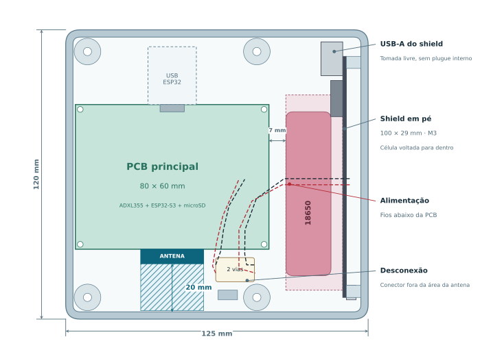

# Caixa v0.10 para ADXL355 e ESP32-S3

A caixa fechada mede **125 × 120 × 43 mm**, sem contar as cabeças dos parafusos. A PCB principal de 80 × 60 mm fica deitada, e o shield 18650 V3 de 100 × 29 mm fica em pé, com a célula voltada para dentro. A folga nominal de 20 mm à frente da antena considera uma projeção de 6 mm além da borda da PCB. Confira essa projeção, os conectores e a altura das soldas no seu conjunto antes de imprimir.

| Peça | Projeto Bambu Studio | Malha STL |
|---|---|---|
| Base | [Caixa v0.10 · A1 e PLA](projetos_3mf/01_Caixa_v010_A1_PLA.3mf) | [Base em mm](stl/01_caixa_compacta_shield_vertical.stl) |
| Tampa | [Tampa v0.10 · A1 e PLA](projetos_3mf/02_Tampa_v010_A1_PLA.3mf) | [Tampa em mm](stl/02_tampa_compacta.stl) |

Abra os 3MF como projetos no Bambu Studio e confira o fatiamento. O perfil é da Bambu Lab A1 com bico de 0,4 mm, PLA e mesa PEI texturizada. A base usa seis perímetros, fundo sólido até 6 mm e preenchimento giroidal de 35% acima. A camada padrão é de 0,20 mm, com 0,10 mm entre 6 e 14 mm na base. Na prévia, confira o fundo, as pontes dos furos M3 e a região do olhal. Imprima a base com o fundo apoiado na mesa e a abertura para cima; na tampa, deixe a face externa na mesa.

Use a [lista de impressão](LISTA_IMPRESSAO.csv) para conferir gabaritos, arruelas e calibres. Os [gabaritos](projetos_3mf/03_Gabaritos_v09_A1_PLA.3mf) e [auxiliares](projetos_3mf/04_Auxiliares_v09_A1_PLA.3mf) mantêm o nome v0.9 porque suas cotas não mudaram na v0.10.

## Ajuste e montagem

As cotas estão em [dimensoes_v010.json](modelo/dimensoes_v010.json). Abra o [modelo editável](modelo/caixa_adxl355_v010.scad) no OpenSCAD. Use `parte="aberta"` para visualizar a montagem; selecione `parte="base"` ou `parte="tampa"`, renderize com F6 e exporte em STL.

Instale as porcas cativas antes das placas. O shield usa quatro parafusos M3 × 6 mm com arruelas isolantes de 0,4 mm; a PCB usa quatro M2 × 6 mm, e a tampa usa quatro M3 × 10 mm. Acompanhe o [corte da caixa](imagens/02_corte_alturas_e_fios.svg) para conferir o vão sob a PCB, manter os fios longe dos apoios e reservar espaço à frente da antena. Faça um teste de encaixe antes de fixar a base.
