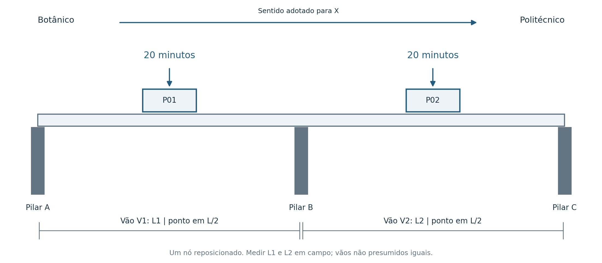
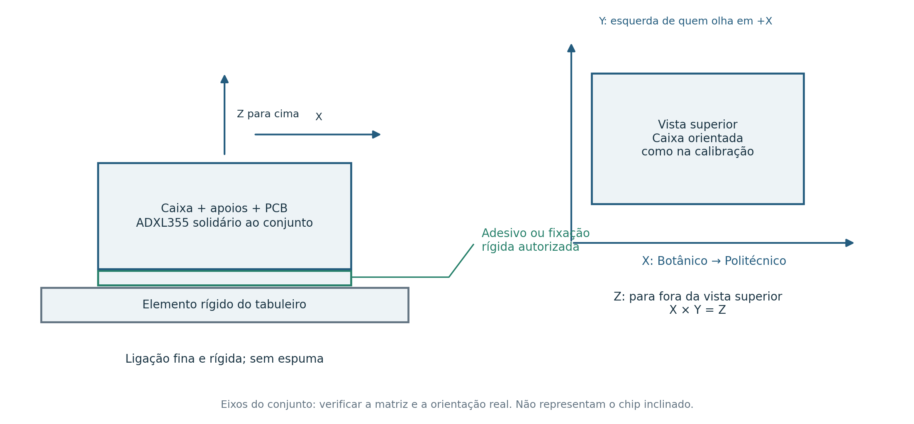
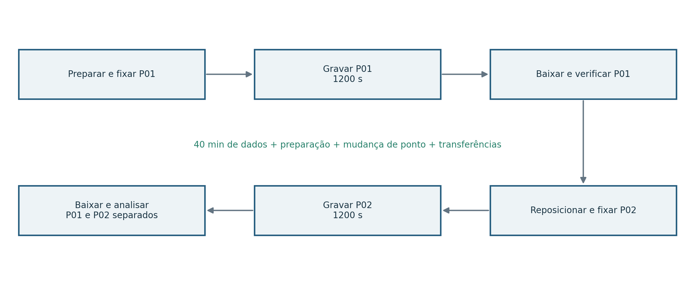

# Passarela UFPR

## Dois pontos, 20 minutos por ponto

Guia de campo · ADXL355 + ESP32-S3 · versão 4.1.0 · 11 de novembro de 2026

Este roteiro utiliza **um único nó sem fio**, transferido de um vão para o outro. Em P01 e P02, o nó grava os três eixos simultaneamente no microSD. Os comandos e o download passam pela rede própria do ESP32-S3; não é necessário roteador ou internet no local.

| Ponto | Localização a conferir em campo | Registro |
| --- | --- | --- |
| P01 | Meio do vão V1, entre os eixos dos pilares A e B | Uma aquisição de 1200 s |
| P02 | Meio do vão V2, entre os eixos dos pilares B e C | Uma aquisição de 1200 s |

Adote A-B-C no sentido Botânico → Centro Politécnico e confirme essa identificação no croqui. As letras são convenções desta campanha. Os comprimentos L1 e L2 devem ser medidos separadamente; não foram considerados iguais.

São **40 minutos de dados**, além de montagem, estabilização, deslocamento e transferência. O objetivo é estimar frequências candidatas da resposta operacional e examinar sua consistência temporal e entre posições. A campanha não fornece formas modais espaciais, fase entre P01 e P02 ou avaliação de segurança estrutural.

<!-- PAGEBREAK -->

## 1. Preparação antes de ir ao local

Leve o conjunto final montado, microSD já testado, alimentação com autonomia conhecida, notebook com Python e dependências instalados, celular para fotos/horários, trena e o material de fixação autorizado. Leve cópia da calibração correta do mesmo exemplar e da mesma montagem interna, além de uma forma de fazer backup.

**Teste a campanha completa na bancada:** duas gravações de 20 minutos, com o mesmo cartão, alimentação e Wi-Fi que serão usados em campo, seguidas de download e análise. Isso verifica duração, armazenamento e transferência; um teste de 30 s não cobre falhas de gravação longa. Não use esse teste como dado da passarela.

| Conferência | O que deve estar resolvido antes da saída |
| --- | --- |
| Alimentação | Autonomia medida para aquecimento, duas coletas, transferências e uma margem; o firmware não mede porcentagem de bateria |
| microSD | Pelo menos 200 MB livres como margem operacional; cartão reconhecido e sem falhas no teste longo |
| Computador | Pelo menos 1 GB livre para bruto, CSV, resultados e cópia de segurança |
| Calibração | JSON matricial real; mesmo sensor, montagem, faixa e configuração de aquisição |
| Fixação | Ligação rígida e reposicionável já planejada; acesso autorizado aos pontos |

A 500 Hz, um registro de 20 minutos contém nominalmente 600 mil amostras e cerca de 19,2 MB de registros binários, além dos cabeçalhos e arquivos auxiliares. O CSV ocupa mais espaço. O total efetivo depende do relógio do sensor; não se exige exatamente 600 mil linhas.

Faça a verificação funcional e consulte a validação independente da matriz antes da campanha. A preparação deste roteiro **não refaz nem aprova** a calibração. Se a validação ainda tiver ressalvas, registre-as e trate a identificação como exploratória, especialmente as comparações de amplitude e direção.

<!-- PAGEBREAK -->

## 2. Encontrar os pontos e fixar o conjunto

1. Identifique os três pilares e fotografe uma vista geral. Meça L1 entre os eixos dos apoios A-B e L2 entre B-C, usando a mesma convenção longitudinal nos dois vãos.
2. Marque P01 na metade de L1 e P02 na metade de L2. Registre a distância real ao apoio e a posição transversal. Se não puder ficar exatamente no meio, documente o desvio, sem mudar silenciosamente o nome do ponto.
3. Escolha um elemento do tabuleiro com ligação rígida à estrutura. Evite guarda-corpo, chapa de acabamento solta, tampa e peças que possam vibrar localmente.
4. Prenda a base por uma fixação rígida autorizada. Mantenha o nó imóvel e proteja o conjunto contra queda e circulação de pessoas.

Oriente o **referencial do conjunto** com X longitudinal, do Botânico ao Politécnico; Y para a esquerda de quem olha em +X; Z para cima. Confira se esses eixos correspondem à matriz aplicada e à posição física da caixa. Não se guie apenas pelos eixos impressos no chip inclinado.

A matriz corrige o sensor em relação à base calibrada; ela não detecta a orientação geográfica da caixa. Se a superfície de apoio estiver inclinada, registre a inclinação ou declare os eixos como locais do tabuleiro, em vez de chamar automaticamente Z de vertical global.

Para uma ligação adesivada, prepare a superfície e respeite a cura do produto. Uma cola que ainda não curou não permite transferência imediata entre os pontos. Planeje previamente como remover e refazer uma ligação rígida, ou utilize uma fixação rígida reversível autorizada. Não coloque espuma entre base e estrutura. Preserve o espaço interno de 20 mm à frente da antena e mantenha o metal afastado de sua face externa tanto quanto a instalação permitir.

<!-- PAGEBREAK -->

## 3. Preparar os programas e a campanha

Extraia o ZIP em uma pasta nova. Preserve os dados e o ambiente anterior. No PowerShell aberto na raiz do novo pacote, crie o ambiente, caso ainda não exista, **antes** de se conectar à rede sem internet do nó:

~~~powershell
py -m venv .venv
$py = ".\.venv\Scripts\python.exe"
& $py -m pip install -r .\requirements.txt
~~~

Se já houver um ambiente funcional nessa pasta, basta definir `$py`. Os nomes têm sublinhados normais: `27_passarela_ufpr.py`, sem uma barra antes de cada sublinhado.

Copie o **JSON real da calibração matricial escolhida** para `dados\calibracao\calibracao.json`. Use a calibração válida do exemplar, com a montagem e os parâmetros de aquisição da campanha.

Crie a campanha, ainda sem enviar comandos ao nó:

~~~powershell
& $py .\python\27_passarela_ufpr.py preparar `
  --calibracao ".\dados\calibracao\calibracao.json"
~~~

O programa cria uma pasta com data, hora e identificador exclusivo, copia a calibração sem alterá-la e imprime o caminho de `campanha.json`. Defina a variável abaixo **com o caminho que apareceu no seu computador**:

~~~powershell
$campanha = "CAMINHO_EXIBIDO_PARA_CAMPANHA.JSON"
~~~

Use essa mesma campanha para P01, P02, consultas e retomadas. O programa extrai sensor, montagem e taxa do JSON, exige faixa ±2 g e configuração compatível, e programa exatamente uma aquisição de 1200 s por ponto. A calibração fica identificada por SHA-256. Não substitua sua cópia dentro da campanha depois da preparação.

<!-- PAGEBREAK -->

## 4. Energizar, conectar e conferir o nó

Energize o conjunto e espere a inicialização. No notebook, conecte à rede **ADXL355-ENSAIOS**, com senha inicial **Ensaio355!**, se não foi modificada. Aceite permanecer conectado mesmo quando o Windows informar que a rede está sem internet. Não troque para outra rede durante os comandos ou o download.

Abra `http://192.168.4.1` e clique em Identificação. Também é possível consultar pelo Python:

~~~powershell
& $py .\python\17_controlar_campanha.py info
& $py .\python\27_passarela_ufpr.py status $campanha
~~~

| Informação | Conferência |
| --- | --- |
| Identificação do sensor | Modelo ADXL355; identificadores AD/MST/PART esperados 0xAD, 0x1D e 0xED |
| sensor_pronto | true |
| sd_pronto e tarefas_prontas | true |
| ocupado | false antes de iniciar |
| Espaço livre | Compatível com o registro e sua margem |

A espera de estabilização deve seguir o ensaio térmico do conjunto. Se esse tempo ainda não foi determinado, pode-se reservar provisoriamente 20 minutos após energizar como decisão conservadora de planejamento, registrando que esse tempo **não foi validado experimentalmente**. Observe as médias em repouso antes de começar. Não transforme essa espera em uma alegação de estabilidade térmica demonstrada.

Mantenha alimentação e montagem interna entre P01 e P02. Se desligar o nó ou alterar sua fixação, registre o ocorrido e espere novamente a estabilidade aplicável. A energia para o aquecimento e as transferências precisa entrar no orçamento de autonomia, além dos 40 minutos de aquisição.

O firmware v4.0 já aceita 1200 s. O programa 27 funciona com ele. O firmware v4.1 acrescenta atalhos P01/P02 à página, sem mudar o formato bruto. Para preservar o controle da campanha, execute os inícios pelo programa 27; não misture com inícios avulsos pelo navegador.

<!-- PAGEBREAK -->

## 5. Iniciar P01 e acompanhar os 20 minutos

Com o nó fixo em P01, confira ponto, orientação, alimentação, cartão e área ao redor. Fotografe a montagem e anote o horário. Então execute:

~~~powershell
& $py .\python\27_passarela_ufpr.py iniciar $campanha `
  --ponto P01 --confirmar-montagem
~~~

`--confirmar-montagem` registra que você conferiu fisicamente a instalação. Não há pergunta interativa que possa ser encerrada por Enter vazio. O comando agenda 10 s de espera e depois **1200 s de gravação**. Esses 10 s não fazem parte dos 20 minutos de dados.

Consulte o andamento quando desejar:

~~~powershell
& $py .\python\27_passarela_ufpr.py status $campanha
~~~

Procure `ocupado`, `estado`, `run_id`, `tempo_registrado_s`, amostras gravadas e eventuais erros. O início de uma gravação é feito uma única vez por tentativa. Consultar o estado não inicia outra aquisição.

Afaste-se após o comando e evite tocar na caixa, no piso imediatamente ao lado ou na alimentação. O nó continua gravando no cartão se o notebook fechar ou perder a rede. A configuração padrão mantém o Wi-Fi ativo para consultas; a transferência dos dados é posterior.

Observe a operação normal da passarela. Não produza saltos sincronizados, golpes ou aglomeração como parte desta campanha. Anote passagens de pedestres, grupos, corridas, vento perceptível e atividades próximas. Esses acontecimentos ajudam a interpretar os picos e variações da resposta.

**Não desligue ao completar 20 minutos no relógio do celular.** O nó ainda precisa finalizar o arquivo e calcular seus registros de integridade. Aguarde a indicação de que a sequência terminou, o nó está ocioso e o arquivo foi finalizado.

<!-- PAGEBREAK -->

## 6. Baixar P01 antes de mudar de ponto

Depois que o nó estiver ocioso, execute:

~~~powershell
& $py .\python\27_passarela_ufpr.py baixar $campanha `
  --ponto P01
~~~

O programa recupera o identificador da tentativa, baixa os arquivos, confere hashes, converte o binário e verifica a correspondência com P01, sensor, montagem e calibração. Ele também confere conclusão, integridade temporal, perdas, saturação e duração observada. A triagem prática admite 1200 ±0,5 s entre a primeira e a última amostra e até ±1% de diferença da taxa nominal.

Essas tolerâncias são critérios de controle deste roteiro, não requisitos publicados de uma norma. O número exato de amostras depende da taxa efetiva. Um arquivo de poucos segundos não é aceito apenas porque seus metadados dizem 1200 s.

Ao receber **P01: arquivo completo e verificado**, faça uma cópia de segurança da pasta da campanha. Preserve também os arquivos no cartão; a confirmação de recebimento enviada ao nó não constitui aprovação metrológica do ensaio e não apaga o bruto.

Se o download cair, reconecte à rede e repita **o mesmo comando baixar**. A transferência reutiliza a tentativa e os arquivos válidos, retomando os trechos pendentes. Não envie outro início para resolver um download interrompido.

Somente após verificar P01, remova o conjunto da fixação de modo adequado e instale-o em P02. O programa impede iniciar P02 enquanto P01 não tiver um arquivo verificado na campanha.

<!-- PAGEBREAK -->

## 7. Repetir a sequência em P02

Fixe o nó no meio do vão B-C, com a mesma convenção de eixos. Registre o apoio utilizado, as coordenadas e qualquer diferença na ligação com o tabuleiro. Não altere a posição do ADXL355 na PCB nem o aperto dos apoios internos: isso mudaria a montagem que foi calibrada.

Espere a fixação ficar estável e a cura aplicável. Confira a rede, o estado do nó e a alimentação. Execute:

~~~powershell
& $py .\python\27_passarela_ufpr.py iniciar $campanha `
  --ponto P02 --confirmar-montagem

& $py .\python\27_passarela_ufpr.py status $campanha
~~~

Após os 1200 s e a finalização, baixe:

~~~powershell
& $py .\python\27_passarela_ufpr.py baixar $campanha `
  --ponto P02
~~~

Faça outro backup. Preserve uma foto do posicionamento em cada ponto e preencha `eventos_campo.csv`, criado na pasta da campanha. Há também uma ficha resumida em `fichas/passarela_ufpr_2p_MODELO.csv`.

| Registrar em cada ponto | Finalidade |
| --- | --- |
| Início/fim e identificação da tentativa | Relacionar o diário com o registro correto |
| Posição longitudinal/transversal, foto e eixos | Permitir reposicionar o conjunto |
| Fixação e condição da superfície | Interpretar diferenças da transmissão mecânica |
| Pedestres, sentido, eventos e horário | Relacionar a resposta à excitação operacional |
| Vento perceptível e temperatura, se medida | Documentar condições ambientais sem inventar valores |

Se conseguir estimar a cadência de um pedestre, anote como ela foi medida; por exemplo, número de passos dividido pelo intervalo observado. Não preencha uma cadência presumida só porque há um pico no espectro.

As duas medições são sucessivas. Pedestres e vento podem mudar entre elas; portanto, diferenças de RMS não representam automaticamente ganho do sensor ou diferença de rigidez entre os vãos.

<!-- PAGEBREAK -->

## 8. Processar os dois registros

A análise pode ser feita fora da passarela e sem conexão ao nó. Abra o PowerShell na pasta do pacote, defina `$py` e o caminho da mesma campanha. Execute:

~~~powershell
& $py .\python\27_passarela_ufpr.py analisar $campanha
~~~

Se registrou cadências em campo, informe-as por ponto. Exemplo de sintaxe, **não valores medidos desta passarela**:

~~~powershell
& $py .\python\27_passarela_ufpr.py analisar $campanha `
  --cadencia-p01 1.8 --cadencia-p02 2.0
~~~

Não use os números do exemplo sem observação correspondente. A opção pode ser repetida para mais de uma cadência no mesmo ponto. O programa sinaliza coincidências com seus múltiplos para revisão.

Cada execução cria uma nova pasta de resultados. O programa preserva a calibração da campanha, confere novamente os arquivos, aplica a matriz no computador e analisa P01 e P02 separadamente. Não une os dados em uma série artificial de 40 minutos.

| Etapa | Configuração inicial |
| --- | --- |
| PSD de Welch | Hann de 64 s, 50% de sobreposição, remoção da média em cada segmento |
| Banda examinada | 0,5 a 50 Hz, mantendo o bruto original |
| Verificação temporal | Quatro blocos, aproximadamente 5 min cada |
| Triagem de picos | Proeminência de 6 dB e ocorrência em pelo menos 3 dos 4 blocos |
| Complemento | FDD dos três canais simultâneos em cada ponto |

Os primeiros 2 s são descartados somente na análise; os 20 minutos continuam no bruto. A grade espectral é aproximadamente 0,0156 Hz e a largura equivalente de ruído da Hann é aproximadamente 0,0234 Hz. Nenhum desses números é, isoladamente, a incerteza da frequência estimada.

<!-- PAGEBREAK -->

## 9. Ler os resultados e decidir sobre as frequências

Comece pela qualidade do registro. Só depois examine a PSD e as candidatas. O programa cruza picos próximos entre canais e arquivos; a tabela consolidada serve para revisão, sem nomear automaticamente modos.

| Arquivo ou figura | O que examinar |
| --- | --- |
| qualidade_passarela.json | Duração, continuidade, taxa efetiva e origem dos dados de cada aquisição |
| qualidade_e_rms_por_ponto.csv | Resumo de P01 e P02, com RMS na banda de análise |
| frequencias_candidatas.csv | Frequência, canal, método, proeminência, persistência e dispersão entre blocos |
| passarela_espectros.png e espectrograma | Picos, energia por direção, permanência e eventos passageiros |
| frequencias_para_revisao.csv | Grupos de frequências próximas e campos para decisão e justificativa |
| comparacao_psd_pontos.png | Espectros dos dois pontos sucessivos; excitações podem diferir |

Uma atribuição a frequência natural ganha apoio quando o pico reaparece em blocos e em posições onde o modo é observável, tem direção compatível com a resposta estrutural e persiste sob variação da excitação. Verifique se uma linha corresponde a passos, seus harmônicos, motor, rede elétrica ou outro agente periódico.

Um pico presente em apenas um ponto não deve ser descartado automaticamente: o outro pode estar próximo de um nó modal ou ter recebido pouca excitação. Um pico presente nos dois pontos também não se torna natural apenas pela coincidência. O intervalo de agrupamento das candidatas é uma convenção de processamento, não uma incerteza nem prova de identidade modal.

Os quatro blocos vêm de uma mesma aquisição: não são quatro ensaios independentes. Com um arquivo em cada ponto, esta primeira campanha oferece verificação interna e comparação entre posições, mas não quantifica a repetibilidade entre dias ou remontagens.

Se as candidatas forem ambíguas, reporte a ambiguidade e planeje registros adicionais em outra condição de ocupação ou posição. Não force a seleção de uma frequência só para obter um valor de primeiro modo.

<!-- PAGEBREAK -->

## 10. O que fazer se algo interromper o roteiro

**O notebook perdeu o Wi-Fi ou fechou:** reconecte e consulte `status`. O nó grava autonomamente. Não execute `preparar` outra vez e não envie um novo início sem saber o que ocorreu com o anterior.

**O início retornou erro ou resultado incerto:** o identificador do comando já ficou salvo em `campanha.json` antes do envio. Consulte o estado e tente baixar a mesma tentativa depois da conclusão. O programa bloqueia um segundo início enquanto houver pendência.

**O nó reiniciou e esqueceu o último identificador na RAM:** liste os arquivos e identifique o registro correspondente pelos metadados. A opção `--run` associa o arquivo à tentativa local; a correspondência é conferida antes de aceitar os dados:

~~~powershell
& $py .\python\17_controlar_campanha.py listar

& $py .\python\27_passarela_ufpr.py baixar $campanha `
  --ponto P01 --run IDENTIFICADOR_REAL_DO_REGISTRO
~~~

Não escolha um arquivo só pelo horário aproximado se posição, sensor ou `request_id` não coincidirem. Se nenhum registro corresponder, preserve a campanha e os logs para diagnóstico, em vez de editar identificadores para contornar a conferência.

**O registro foi rejeitado ou o nó informou falha:** preserve os arquivos e o motivo. Com o nó ocioso e o problema resolvido, faça uma nova aquisição completa, sem acrescentar minutos a um trecho parcial:

~~~powershell
& $py .\python\27_passarela_ufpr.py iniciar $campanha `
  --ponto P01 --confirmar-montagem --nova-tentativa `
  --motivo "Descrever o problema e a correcao realizada"
~~~

Depois use `baixar` para esse ponto. A tentativa anterior permanece no histórico; o novo registro verificado passa a ser o selecionado. Não repita ou exclua um resultado apenas porque sua frequência ou amplitude não era a esperada. Antes de repetir P01 após medir P02, devolva fisicamente o nó à posição correta e documente a mudança.

<!-- PAGEBREAK -->

## 11. Limites do arranjo e relação com a literatura

O procedimento utiliza a resposta à excitação operacional, sem medir a força. A PSD de Welch reduz a variância do espectro pela média de segmentos; sua interpretação permanece condicionada à excitação e à observabilidade. A FDD de Brincker, Zhang e Andersen trabalha sobre a matriz espectral dos canais simultâneos. Neste arranjo, esses canais são X/Y/Z do mesmo ponto.

Como P01 e P02 são medidos em horários diferentes, o pacote **não calcula fase entre os pontos, deformada modal espacial, MAC espacial ou amortecimento automático**. Para estimar formas modais, seria necessário ampliar a instrumentação e controlar o sincronismo, ou utilizar uma referência fixa em um procedimento especificamente validado.

Os meios dos vãos são posições úteis para observar certas respostas de flexão, mas podem coincidir com nós de outros modos. Eles não garantem observar todos os modos nem, necessariamente, o primeiro. Dois vãos de uma passarela podem participar de modos globais acoplados; não se deve chamar cada pico de “frequência do seu vão” apenas pelo ponto onde foi observado.

Medeiros, Faggion e Alves (2020) estudaram a mesma passarela com estação total robotizada e GNSS. Essa fonte ajuda a contextualizar a estrutura e a comparação de técnicas. Seus pontos e condições não são automaticamente os desta campanha. Não copie comprimentos parciais, frequências ou coordenadas sem conferir a definição e a geometria em campo.

Hasani et al. (2024) documentam um sistema sem fio com ADXL355 e ESP32 para OMA de pontes. Esse trabalho sustenta a pertinência da cadeia MEMS, armazenamento e comunicação, mas não valida este hardware ou seu relógio por associação. A literatura e os guias de passarelas também mostram a importância de reconhecer a excitação de pedestres.

**Duas posições de meia extensão, 20 minutos por ponto, quatro blocos, 6 dB e 75% de persistência são decisões operacionais deste projeto.** As fontes fundamentam os métodos, sem impor esses números como protocolo universal.

<!-- PAGEBREAK -->

## 12. Referências para relatar o procedimento

Consulta das fontes novas: 11 nov. 2026. As referências adicionais de bancada, comparação e OMA permanecem em `METODOLOGIA_E_REFERENCIAS.md`. Os textos completos das fontes não são redistribuídos neste pacote.

MEDEIROS, Leandro Ítalo Barbosa de; FAGGION, Pedro Luís; ALVES, Samir de Souza Oliveira. Análise do Desempenho de ETR no Monitoramento Dinâmico de Estrutura Metálica por Leitura Contínua de Direções. Revista Brasileira de Cartografia, v. 72, n. 2, p. 280-293, 2020. DOI: 10.14393/rbcv72n2-52637. https://seer.ufu.br/index.php/revistabrasileiracartografia/article/view/52637

HASANI, Hamed; FREDDI, Francesco; PIAZZA, Riccardo; CERUFFI, Fabio. A Wireless Data Acquisition System Based on MEMS Accelerometers for Operational Modal Analysis of Bridges. Sensors, v. 24, n. 7, art. 2121, 2024. DOI: 10.3390/s24072121. https://pmc.ncbi.nlm.nih.gov/articles/PMC11014100/

BRINCKER, Rune; ZHANG, Lingmi; ANDERSEN, Palle. Modal identification of output-only systems using frequency domain decomposition. Smart Materials and Structures, v. 10, n. 3, p. 441-445, 2001. DOI: 10.1088/0964-1726/10/3/303.

WELCH, Peter D. The use of fast Fourier transform for the estimation of power spectra: a method based on time averaging over short, modified periodograms. IEEE Transactions on Audio and Electroacoustics, v. 15, n. 2, p. 70-73, 1967. DOI: 10.1109/TAU.1967.1161901.

HEINEMEYER, Christoph et al. Design of Lightweight Footbridges for Human Induced Vibrations. Luxembourg: Office for Official Publications of the European Communities, 2009. EUR 23984 EN. DOI: 10.2788/33846. https://eurocodes.jrc.ec.europa.eu/publications/design-lightweight-footbridges-human-induced-vibrations

SCIPY DEVELOPERS. scipy.signal.welch. Documentação oficial. https://docs.scipy.org/doc/scipy/reference/generated/scipy.signal.welch.html

## Encerramento da campanha

Após os dois downloads verificados, copie a pasta completa da campanha para outro destino. Ela contém a calibração usada, comandos, tentativas, binários, metadados, logs, CSVs e análises. Acrescente as fotos, a ficha e o diário de campo. Só desligue quando o nó estiver ocioso. Preserve os dados brutos e não os regrave pelo Excel; use cópias para visualização.

O software foi verificado com dados e comunicação simulados. Isso não substitui compilação com a toolchain Espressif, teste da placa, verificação longa do cartão e validação experimental da montagem. Consulte `VALIDACAO.md` para distinguir o que foi executado nesta entrega das verificações que dependem do equipamento real.
