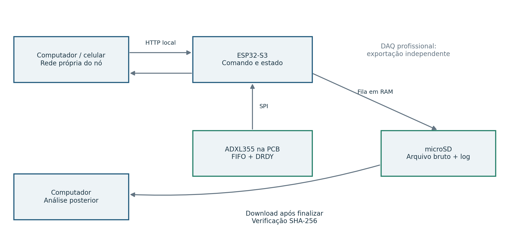
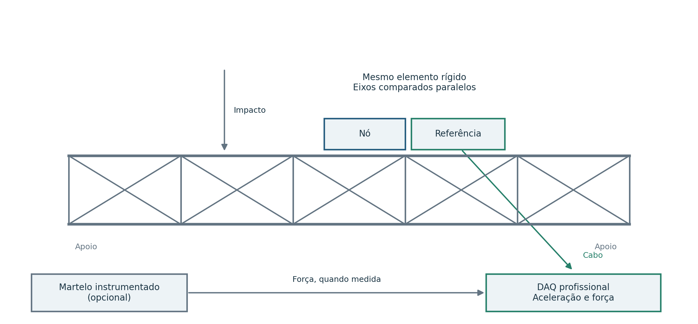
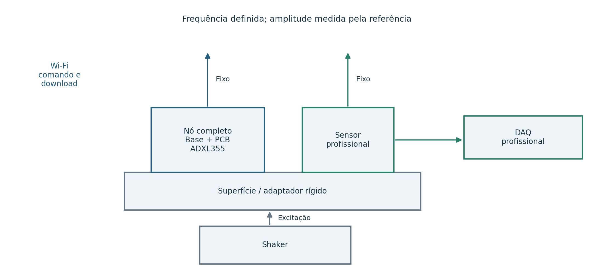
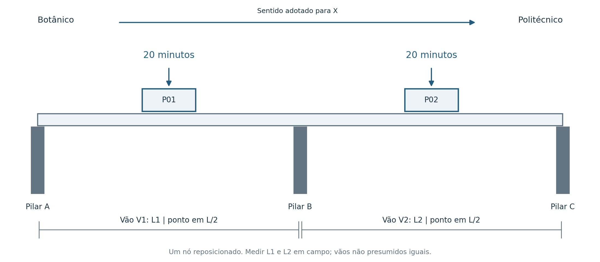

# Guia de aquisição, comparação e identificação de frequências

ADXL355 + ESP32-S3 N16R8 · Wi-Fi próprio e microSD · versão 4.1.0

TFC Isaque · 11 de novembro de 2026

## 1. O que será realizado

Este pacote organiza três campanhas. Na treliça, compara a resposta do nó e de um acelerômetro profissional ao mesmo impacto. No shaker, compara amplitudes e frequências sob excitação senoidal estacionária. Na passarela, registra vibração operacional e procura frequências candidatas a naturais. A caracterização de bancada continua disponível para conferir a montagem antes e depois das campanhas.

O nó inicia mediante comando remoto, registra localmente e só libera o download depois de finalizar a sequência. O computador não precisa permanecer conectado durante a aquisição. A perda do Wi-Fi não deve interromper o trabalho já aceito pelo firmware. A alimentação deve permanecer estável até o término da gravação e da geração dos hashes.

O cenário adotado é **um ADXL355 triaxial, montado na PCB com ESP32-S3 e microSD**, mais um sistema profissional independente nas comparações de laboratório. O modelo do instrumento profissional, o condicionador, a DAQ e o eventual canal de força precisam ser registrados na ficha; o programa não presume equipamentos específicos a partir dos usados em artigos.

O pacote registra os dados brutos do ADXL355. A matriz de calibração é aplicada no computador. Ela deve corresponder ao exemplar, à faixa, à taxa/filtro e à montagem efetivamente utilizada, incluindo a inclinação fixa do módulo.

## 2. Arquivos e preparação do computador

Extraia o ZIP inteiro para uma pasta de trabalho. Mantenha a pasta `firmware`, a pasta `python`, os perfis de `configuracoes`, as fichas e a documentação juntas. Para facilitar os comandos, use uma pasta curta, por exemplo `C:\TFC\ADXL355_Campo`. A localização no OneDrive não é obrigatória.

Instale Python de 64 bits, preferencialmente 3.12, e Arduino IDE com o pacote de placas ESP32. As dependências devem ser instaladas enquanto o computador ainda tem internet. A rede criada pelo ESP32 não fornece internet.

Abra o PowerShell na pasta que contém `requirements.txt` e execute, uma linha por vez:

~~~powershell
py -m venv .venv
.\.venv\Scripts\python.exe -m pip install -r .\requirements.txt
$py = '.\.venv\Scripts\python.exe'
& $py .\python\17_controlar_campanha.py --help
~~~

A variável `$py` é apenas um atalho nesta janela do PowerShell. Se abrir outra janela, defina-a novamente ou utilize o caminho completo do Python. Não copie uma pasta `.venv` de outro projeto ou computador.

Se aparecer `NameResolutionError` envolvendo `pypi.org`, a criação do ambiente pode ter terminado, mas o download de bibliotecas falhou por rede/DNS. Reconecte-se à internet e repita apenas a instalação. Essa mensagem, sozinha, não demonstra incompatibilidade do NumPy.

Os sublinhados fazem parte dos nomes. Por exemplo, use `17_controlar_campanha.py`; não insira barras antes de `_`. Copie os comandos dos blocos do arquivo Markdown quando a quebra de linha do PDF dificultar a seleção.

## 3. Conferir a PCB e os barramentos

O mapa abaixo preserva o pacote wireless v3 recuperado. Confira-o com a sua montagem real antes de gravar. GPIO é o número lógico, não a posição física do pino na placa.

| Componente | Terminal | ESP32-S3 |
| --- | --- | --- |
| ADXL355 | VCC | 3V3 |
| ADXL355 | GND | GND |
| ADXL355 | CS/SCL | GPIO10 |
| ADXL355 | MOSI/SDA | GPIO11 |
| ADXL355 | SCLK | GPIO12 |
| ADXL355 | MISO/AS ou MISO/ASEL | GPIO13 |
| ADXL355 | DRDY | GPIO14 |
| ADXL355 | INT1 | Sem conexão nesta versão |
| microSD 3,3 V | VCC | 3V3 |
| microSD | GND | GND |
| microSD | CS | GPIO15 |
| microSD | SCK/CLK | GPIO16 |
| microSD | MOSI | GPIO17 |
| microSD | MISO | GPIO18 |
| USB nativo | D- / D+ | GPIO19 / GPIO20 reservados |

O sensor e o cartão usam barramentos SPI separados. Isso permite que a aquisição mantenha prioridade enquanto a outra tarefa grava blocos no cartão. O firmware utiliza FIFO e DRDY do ADXL355, uma fila de amostras em RAM e registros binários com CRC32. O envio ao computador inclui verificação SHA-256.

Se a PCB tiver outro mapa já testado, altere os valores de `config.h` para refletir as ligações existentes. Não troque os fios por tentativa. O programa profissional não se conecta aos pinos do ADXL355: permanece na própria DAQ, com alimentação e condicionamento apropriados ao seu modelo.

Faça mudanças de ligação com USB e bateria desconectados. Use o cartão FAT32 já testado. O firmware não formata nem apaga o cartão. O shield pode alimentar o ESP32 pela entrada USB de alimentação adequada da placa; confirme o circuito da sua placa antes de usar simultaneamente outra alimentação.

## 4. Gravar o firmware pelo USB nativo

Abra `firmware/adxl355_wifi_sd/adxl355_wifi_sd.ino`. Os arquivos `node.cpp`, `config.h`, `format.h` e `web_ui.h` devem estar na mesma pasta. Não é necessário instalar bibliotecas Arduino de terceiros: WiFi, WebServer, SPI, SD e Preferences pertencem ao core Arduino-ESP32.

Para a sua placa ESP32-S3 N16R8, a seleção genérica `ESP32S3 Dev Module` é adequada quando o fabricante não fornece uma definição específica. N16 indica 16 MB de flash e R8 indica 8 MB de PSRAM. Este firmware não depende da PSRAM.

| Opção no Arduino IDE | Ajuste inicial |
| --- | --- |
| Board | ESP32S3 Dev Module |
| Flash Size | 16 MB, confirmado pela variante N16R8 |
| Partition Scheme | Huge APP, quando disponível, com aplicativo de cerca de 3 MB |
| PSRAM | Disabled inicialmente |
| USB Mode | Hardware CDC and JTAG, quando essa opção existir |
| USB CDC On Boot | Enabled |
| Upload Mode | UART0 / Hardware CDC, conforme o menu do core |
| Upload Speed | 115200 para a primeira gravação |
| Port | COM correspondente ao conector USB nativo |

A tabela Huge APP usual ocupa apenas parte dos 16 MB, mas o armazenamento dos ensaios fica no microSD. Não é necessário reservar flash para todos os registros. O pacote não implementa atualização OTA.

Confira o SSID, a senha e os GPIOs em `config.h`. O padrão é `ADXL355-ENSAIOS`, senha `Ensaio355!`. Altere a senha antes de uma campanha acessível a outras pessoas e registre o novo valor na sua documentação privada.

Compile e depois clique em Carregar. Se ficar em `Connecting...`, pressione BOOT, mantenha pressionado, pressione e solte EN e libere BOOT quando começar a escrita. Após a primeira gravação, pressione EN se necessário. Abra o Monitor Serial em **115200 baud**, com **Nova linha**, e envie `INFO`.

Os identificadores esperados são AD = 0xAD, MST = 0x1D e PART = 0xED. REVID é registrado conforme o componente. Confira `sensor_pronto=1`, `sd_pronto=1` e `tarefas_prontas=1`. Esses campos validam as verificações implementadas, não a exatidão da medição.

O script opcional `ferramentas/compilar_arduino.ps1` indica o core 3.3.2 como alvo reproduzível e não faz upload. Ele não foi executado com uma toolchain real neste ambiente. A verificação C++ disponível usa interfaces simuladas; compile no Arduino IDE e valide a placa antes dos ensaios.

## 5. Operar pela rede própria

1. Energize o nó e espere a inicialização.
2. No computador ou celular, conecte-se a `ADXL355-ENSAIOS`.
3. Se o Windows avisar que a rede não tem internet, mantenha a conexão.
4. Abra `http://192.168.4.1` no navegador.
5. Clique em Identificação e confira sensor, cartão e tarefas.
6. Selecione o perfil Treliça, Shaker ou Passarela, ou carregue um JSON pelo programa Python.
7. Confira os identificadores, a posição, a faixa e a duração antes de iniciar.
8. Aguarde o estado de aquisição e acompanhe o tempo registrado.
9. Espere a conclusão e a liberação do cartão para baixar os arquivos.

O Wi-Fi permanece ativo nos perfis novos. Com a opção rádio desligado, não será possível consultar ou interromper pelo Wi-Fi durante a aquisição; a rede volta ao final. Use inicialmente o rádio ativo para atender ao comando remoto pretendido. Compare o desempenho com rádio ativo e desligado na bancada antes de escolher outro regime.

Exemplo de consulta e início pelo PowerShell:

~~~powershell
$py = '.\.venv\Scripts\python.exe'
& $py .\python\17_controlar_campanha.py info
& $py .\python\17_controlar_campanha.py iniciar `
  .\configuracoes\trelica_impacto.json
& $py .\python\17_controlar_campanha.py status
~~~

O comando de início retorna sem bloquear o terminal. Assim você pode acompanhar a DAQ profissional e consultar o nó durante o ensaio. O programa grava uma cópia do comando e de seu identificador. Um resultado incerto após falha de rede exige consultar STATUS, não enviar outro início por tentativa.

Para iniciar, aguardar e baixar automaticamente, acrescente `--acompanhar` ao comando `iniciar`. Para marcar uma observação, use:

~~~powershell
& $py .\python\17_controlar_campanha.py marcar inicio_pedestres
~~~

Essa marca registra o momento de chegada do comando ao ESP32. Ela serve como anotação da campanha, não como sincronismo preciso com a DAQ.

## 6. Baixar e preservar os dados

Ao terminar, liste as aquisições:

~~~powershell
& $py .\python\17_controlar_campanha.py listar
& $py .\python\17_controlar_campanha.py baixar RUN_ID
~~~

Substitua RUN_ID pelo identificador retornado. O programa cria uma pasta nova, baixa binário, metadados, log e manifesto, verifica tamanhos/hashes, converte o binário e só então envia a confirmação de recebimento. A cópia no cartão permanece.

Cada aquisição baixada contém `raw.bin`, `meta.json`, `events.log`, `manifest.json`, `aquisicao.csv`, `aquisicao.json` e o recibo de recebimento. Leve o CSV e seu JSON juntos para qualquer outra pasta. O CSV bruto não deve ser editado nem salvo pelo Excel; utilize cópias para visualização.

As análises criam pastas com data, hora, microssegundos e sufixo aleatório. Isso evita substituir os resultados de uma execução anterior. Cada análise mantém parâmetros e hashes de entrada em `analise.json`.

A 500 Hz, somente os registros de 32 bytes ocupam cerca de **57,6 MB por hora**, com acréscimo de cabeçalhos e metadados. Um registro de 20 minutos ocupa aproximadamente 19,2 MB no formato binário; o CSV é maior. Confira o espaço livre e a autonomia com a duração completa antes de levar o nó à passarela.

## 7. Preparação comum e calibração

Mantenha a geometria da montagem que será utilizada na estrutura. Se a matriz foi obtida para o módulo inclinado, a inclinação pode permanecer, desde que seja fixa e reproduzível. Uma mudança na ligação entre módulo, PCB e base altera o conjunto que deve ser validado.

Antes da campanha:

1. Registre modelo, número de série, configuração e arquivo de calibração de cada cadeia.
2. Confira os eixos do conjunto em relação à estrutura. A matriz corrige a montagem já definida; ela não conhece automaticamente o sentido longitudinal, transversal ou vertical da passarela.
3. Faça a verificação funcional e uma aquisição em repouso.
4. Reavalie pelo menos as seis posições com dados independentes se a montagem foi alterada. Utilize a calibração matricial e a validação herdadas da bancada.
5. Deixe o conjunto aquecer em sua condição de alimentação e caixa. Uma espera inicial de 15 minutos pode orientar a operação, mas não constitui um tempo de estabilização comprovado: confira a evolução das médias e da temperatura e documente a decisão.
6. Registre cinco aquisições de 120 s em repouso, com a fixação de ensaio. Repita uma verificação curta após a campanha para procurar alterações.

Copie a calibração válida para `dados/calibracao/`. Nos perfis, edite `sensor`, `montagem` e `calibracao_id` com os valores da campanha. Informar o ID ao firmware apenas cria rastreabilidade; não aplica coeficientes aos dados. Os programas de análise recebem o arquivo por `--calibracao` e rejeitam incompatibilidades reconhecidas.

A configuração inicial é 500 Hz, ±2 g, LPF de 125 Hz e HPF desligado. Ela preserva a componente contínua no bruto e fornece margem para a banda de 0,5 a 50 Hz. Se houver saturação, reduza a excitação. Ao mudar a faixa, use calibração correspondente; o programa não adapta automaticamente uma matriz de ±2 g para ±4 g ou ±8 g.

## 8. Preparar a referência profissional

O sistema profissional deve registrar a mesma direção física e o mesmo evento do nó. Confira o sensor, a sensibilidade, a faixa, o condicionamento, o filtro e a taxa efetiva de exportação. Sensores IEPE/ICP permanecem ligados ao condicionador apropriado, não a um GPIO do ESP32.

Exporte um CSV com tempo decorrido numérico e aceleração em unidades físicas. Se só houver tensão, a escala precisa vir da sensibilidade real da cadeia. Para impacto instrumentado, exporte também a força medida pelo martelo, no mesmo relógio da aceleração profissional.

Edite `fichas/mapa_referencia.json`. O campo `instrumento_modelo` deve ser preenchido; o importador recusa o marcador PREENCHER. O modelo fornecido assume colunas chamadas Time e Acceleration apenas como exemplo de mapeamento, não como nomes universais.

| Campo | Como preencher |
| --- | --- |
| separador e decimal | Conforme o arquivo exportado; são opções diferentes |
| tempo_coluna | Nome exato da coluna de tempo numérico |
| tempo_unidade | s, ms ou us |
| fs_hz | Somente se não houver coluna de tempo; taxa de exportação confirmada |
| canais.z.coluna | Nome da aceleração na direção comparada |
| unidade | m/s2, g ou V para aceleração; N ou V para força |
| sinal | +1 ou -1, conforme a orientação física |
| fator_para_si | Obrigatório em V: (m/s2)/V ou N/V |
| limite_abs_si | Limite físico do canal, quando conhecido |
| certificado | Identificação do certificado, ou null quando indisponível |

Exemplo apenas de cálculo: 100 mV/g equivale a 0,100 V/g e, usando 9,80665 m/s2 por g, resulta em 98,0665 (m/s2)/V. Não adote esse número sem conferir a sensibilidade do seu equipamento e o ganho do condicionador. O parâmetro `offset_entrada` é expresso na unidade de entrada.

Importe o arquivo:

~~~powershell
& $py .\python\18_importar_referencia.py `
  'C:\Ensaios\exportacao.csv' `
  --mapa .\fichas\mapa_referencia.json
~~~

O importador preserva o original e produz `referencia.csv` e `referencia.json` em uma pasta nova. O tempo passa a começar em zero e a origem é guardada nos metadados. Todos os instantes usados depois, inclusive marcas da DAQ, devem ser expressos nessa mesma origem normalizada.

A importação não verifica a autenticidade do certificado nem a calibração da DAQ. Esses elementos continuam fazendo parte da avaliação experimental e da incerteza da referência.

## 9. Comando remoto e alinhamento temporal

Começar duas aquisições pelo Wi-Fi não torna seus relógios iguais. O relógio do ESP32 marca DRDY; a DAQ profissional tem sua própria base de tempo. Além de um deslocamento inicial, pode haver diferença de escala ao longo do registro.

A rotina utiliza a relação **t_ref = a + b · t_no**, ajustada por marcas correspondentes. Três pares são o mínimo implementado; prefira cinco ou mais, distribuídos antes, durante e depois da janela de comparação. Use intervalos não uniformes entre pulsos para reduzir ambiguidades de correspondência.

Há três níveis de trabalho:

| Situação | Resultado apropriado |
| --- | --- |
| Sem marcas comuns | Comparação de frequência e amplitude estacionária no shaker; espectros e RMS de janelas declaradas do mesmo impacto |
| Marcas identificadas no impacto | Alinhamento aproximado, com erro de localização declarado; atrasos dos sensores permanecem na comparação |
| Pulsos físicos nos dois sistemas | Melhor controle do tempo, condicionado à resolução da DAQ, latência das entradas e validação das marcas |

A entrada opcional de marca é GPIO4 e vem **desativada** em `config.h`. Para utilizá-la, confira primeiro as especificações elétricas da entrada digital da DAQ e do gerador de pulsos. Somente depois ative `ENABLE_SYNC_INPUT=true` e grave o firmware. O ESP32 deve receber um sinal compatível com 3,3 V; não conecte diretamente sinais de 5 V, IEPE, analógicos desconhecidos ou saídas industriais.

O gerador pode distribuir o mesmo pulso à DAQ e ao GPIO4, com referência elétrica/isolação apropriadas ao equipamento. O pino GPIO4 registra a chegada do pulso no relógio do ESP32; ele **não altera o oscilador do ADXL355**. O programa não implementa a sincronização externa interna do sensor, e o terminal INT1 do módulo continua sem ligação.

O log guarda `pulso_externo` e o tempo relativo ao início. Há espaço para 128 marcas por registro; não use um trem rápido de pulsos. Para uma campanha curta, cinco a dez marcas bem espaçadas são suficientes para o ajuste proposto. Confira `marcas_descartadas=0`.

Exporte as marcas do nó:

~~~powershell
& $py .\python\25_extrair_marcas.py `
  'CAMINHO\events.log'
~~~

Preencha `fichas/pares_tempo_MODELO.csv`, com `t_no_s`, `t_ref_s` e `u_par_s`. O último campo representa o erro temporal declarado para cada par, em segundos. Ele deve refletir a resolução de marcação e a identificação dos eventos; não preencha um valor pequeno apenas para obter aprovação.

~~~powershell
& $py .\python\19_ajustar_tempo.py `
  .\fichas\pares_tempo_MODELO.csv `
  --csv-no 'NO\aquisicao.csv' `
  --csv-ref 'REF\referencia.csv' --tipo pulsos
~~~

O resultado informa a, b, diferença relativa em ppm e resíduos. O ajuste é recusado para comparações temporais quando os resíduos excedem três vezes os erros declarados ou quando a escala temporal é implausível para esta aplicação. Essa triagem não é uma certificação de sincronismo.

As janelas comparadas devem ficar entre as marcas extremas: o pacote não extrapola o alinhamento. Não se deve interpretar um baixo resíduo de ajuste como eliminação dos atrasos dos filtros. Por essa razão, esta versão não apresenta uma exatidão de fase entre os equipamentos. A relação 360 · f · erro_temporal é fornecida apenas como diagnóstico da sensibilidade da fase ao erro de tempo.

## 10. Treliça: montagem e ensaio por impacto

Fixe a treliça com os apoios que serão mantidos em toda a campanha. Identifique o ponto de impacto, sua direção, os pontos de medição e o estado de aperto dos apoios. Fotografe o conjunto e registre massas adicionadas, inclusive caixa, bateria, sensor profissional e cabos.

Instale o nó e a referência tão próximos quanto a geometria permitir, no mesmo elemento localmente rígido, com os eixos comparados paralelos e o sinal definido. Meça e registre o afastamento entre os pontos. Em pontos diferentes, uma diferença de amplitude também pode decorrer da resposta estrutural, e não apenas do sensor.

Compare preferencialmente o nó em sua configuração final de fixação. A cadeia estrutura-adesivo-base-apoios-PCB-sensor pode alterar o resultado. Uma comparação do chip isolado não valida automaticamente a caixa montada. Evite apoio sobre regiões flexíveis da PCB e mantenha os cabos da referência com folga e alívio de tração.

### 10.1 Aquisição piloto

1. Inicie a aquisição profissional antes do nó, preservando tempo anterior ao impacto.
2. Envie o perfil `trelica_impacto.json`, de 90 s, com uma única repetição e Wi-Fi ativo.
3. Confirme o estado adquirindo. Espere cerca de 20 s de **tempo registrado**, não 20 s desde o clique.
4. Aplique um impacto leve no ponto e na direção marcados.
5. Espere a resposta decair até se aproximar do nível anterior ao impacto. Não toque nos sensores.
6. Aguarde o fim, baixe o arquivo e confira identificação, continuidade e saturação.
7. Ajuste intensidade, duração e, se instrumentado, a ponta do martelo antes da série definitiva.

A excitação deve conter energia suficiente em 0,5-50 Hz sem saturar os canais. Uma ponta macia pode reduzir a energia nas frequências mais altas; uma ponta rígida pode produzir picos de força excessivos. A escolha depende da treliça, do martelo e do equipamento. Observe a força quando disponível e a resposta medida em ambos os sistemas.

Se o decaimento durar mais que a janela, aumente o registro e o intervalo. Não corte a cauda por conveniência. Impactos duplos, saturação, perda de amostras ou deslocamento da montagem justificam repetir o registro e documentar a exclusão; não escolha impactos apenas porque produziram melhor concordância.

### 10.2 Série comparativa

Faça inicialmente cinco impactos válidos independentes na mesma configuração, um por arquivo. Depois, repita em outra posição ou direção de interesse, mantendo a documentação de montagem. As aquisições automáticas consecutivas não acionam fisicamente o martelo; a execução dos impactos continua manual.

Para cada par, registre o instante do impacto no tempo do CSV do nó e no da referência. Sem alinhamento por marcas, informe explicitamente ambos:

~~~powershell
& $py .\python\21_comparar_trelica.py `
  'NO\aquisicao.csv' 'REF\referencia.csv' `
  --calibracao 'CAL\calibracao.json' `
  --eixo-no z --eixo-ref z `
  --impacto-no 20.0 --impacto-ref 23.4
~~~

Os tempos são exemplos e devem ser substituídos pelos instantes reais. A janela padrão cobre 2 s antes e 40 s depois do impacto. O filtro de comparação é aplicado ao registro completo antes do recorte; são exigidas margens para reduzir efeitos de borda. O programa informa RMS na mesma banda e procura correspondência entre picos espectrais. Sem sincronismo, não informa NRMSE, correlação amostra a amostra ou coerência entre canais.

Com `sincronismo.json` válido, use:

~~~powershell
& $py .\python\21_comparar_trelica.py `
  'NO\aquisicao.csv' 'REF\referencia.csv' `
  --calibracao 'CAL\calibracao.json' `
  --impacto-ref 23.4 `
  --sincronismo 'TEMPO\sincronismo.json'
~~~

A análise alinha pelo ajuste declarado e cria uma grade comum de até 200 Hz. Antes da redução de taxa, aplica filtragem antialias; a interpolação fracionária usa sinc com janela Kaiser. Isso evita a atenuação que uma simples interpolação linear poderia introduzir. Não são preenchidas lacunas de aquisição.

Os resultados temporais incluem NRMSE e correlação na janela comum, sem ajustar a escala ou deslocar o sinal para melhorar os índices. A coerência exportada é um indicador descritivo de compatibilidade; um transiente isolado não equivale a um ensaio estacionário com muitas médias independentes.

### 10.3 Quando houver martelo instrumentado

Se houver força medida em N na mesma DAQ da aceleração profissional, use o mapa com força. O perfil `trelica_frf.json`, de 420 s, permite vários impactos separados. A duração e os intervalos devem ser ajustados ao decaimento observado. O pacote não deduz a força a partir da aceleração nem a partir da intensidade do golpe.

Preencha `fichas/impactos_MODELO.csv` com evento, instante no CSV profissional normalizado, aceito (1 ou 0) e motivo de exclusão. São exigidos pelo menos três impactos utilizáveis, com janelas que não se sobreponham.

~~~powershell
& $py .\python\26_analisar_frf_martelo.py `
  'REF\referencia.csv' `
  --eventos .\fichas\impactos_MODELO.csv `
  --eixo-ref z --pre-s 2 --pos-s 20
~~~

Esse comando calcula H1 e coerência da referência em relação à força. Para incluir o nó, acrescente `--no-csv`, `--calibracao` e `--sincronismo`. O programa exige o alinhamento para essa comparação. A força é filtrada antes da redução à grade comum; a detecção preliminar de múltiplos picos usa o sinal profissional original.

A FRF utiliza uma janela retangular e pressupõe que a resposta tenha decaído dentro dela. Não utiliza janela exponencial nem estima amortecimento. O operador deve verificar a cauda, a qualidade do pulso, a banda excitada e o registro da força. A triagem de duplo impacto e força acima do ruído é exploratória e pode exigir revisão no piloto conforme a forma real do pulso.

Uma FRF de referência/força tem unidade (m/s2)/N. A razão entre acelerações de dois sensores, sem força, não é a mesma grandeza. Baixa coerência ou energia insuficiente da força limita a interpretação. Os níveis de 0,8 de coerência e -20 dB relativos de energia são auxiliares de triagem deste pacote, não limites impostos pela ISO.

## 11. Shaker: frequência e amplitude estacionárias

Fixe os dois sistemas na mesma superfície rígida do shaker, com eixos paralelos à excitação. Confira se a massa do conjunto completo, a fixação e o curso admissível cabem na capacidade do equipamento. Mantenha cabos com folga e sem tracionar a base móvel. Para avaliar a caixa final, ela precisa participar da montagem comparada.

A campanha inicial propõe 1, 2, 5, 10, 15, 20, 30, 40 e 50 Hz, com três repetições em cada frequência. Comece com um nível baixo e, após o piloto, repita níveis adicionais de interesse. Preencha a amplitude **medida pela referência**, não apenas o valor solicitado ao controlador.

Não imponha a mesma aceleração a toda a faixa sem conferir o deslocamento necessário. Em movimento senoidal, a_pico = (2πf)² · x_pico. Nas frequências baixas, uma aceleração moderada pode exigir deslocamento elevado. O fabricante do shaker e a referência medida definem as condições viáveis.

### 11.1 Sequência de uma medição

1. Ajuste a frequência e um nível inicialmente baixo no controlador do shaker.
2. Espere estabilizar e confira o valor profissional e a ausência de saturação.
3. Inicie a DAQ profissional e o perfil `shaker_seno.json`, de 60 s.
4. Mantenha frequência, amplitude e montagem constantes durante o trecho útil.
5. Ao final, salve o arquivo profissional, baixe o nó e importe a referência.
6. Repita a aquisição três vezes antes de mudar de condição, ou documente outra ordem que permita observar deriva.

O ajuste senoidal utiliza janelas internas, por padrão de 10 s após o início até 5 s antes do fim de cada arquivo. Exige pelo menos 20 ciclos na janela. As janelas podem ter origens diferentes, pois a comparação principal é de frequência e amplitude estacionárias; fase entre os equipamentos não é calculada.

~~~powershell
& $py .\python\20_analisar_shaker.py `
  'NO\aquisicao.csv' 'REF\referencia.csv' `
  --calibracao 'CAL\calibracao.json' `
  --frequencia 10 --eixo-no z --eixo-ref z `
  --nivel baixo --repeticao 1
~~~

O programa ajusta a frequência próxima da comandada e estima seno, cosseno, nível contínuo e tendência linear. A amplitude RMS da fundamental é a amplitude de pico dividida por raiz de 2. O desvio de amplitude é 100 · (A_no/A_ref - 1); o de frequência é 100 · (f_no/f_ref - 1).

A frequência efetiva de cada arquivo participa da análise. A diferença encontrada em frequência inclui diferenças entre as bases de tempo e não deve ser atribuída automaticamente ao elemento MEMS. A frequência comandada orienta a busca, mas não substitui a frequência medida pela referência.

Também são informados o resíduo RMS do ajuste e um indicador de harmônicos da saída. Esse indicador descreve os dados disponíveis; não identifica sozinho se a distorção veio do shaker, da fixação, do sensor ou de interferências.

Para resumir as repetições:

~~~powershell
& $py .\python\24_resumir_shaker.py `
  'ANALISE_R01' 'ANALISE_R02' 'ANALISE_R03'
~~~

O resumo agrupa por frequência comandada e nível. A dispersão entre aquisições não é uma incerteza expandida. Defina os critérios de desempenho da pesquisa antes de selecionar os resultados, considerando a incerteza da referência, a montagem e a aplicação. O pacote não emite uma aprovação automática como calibração acreditada ou conforme à ISO 16063-21.

## 12. Passarela UFPR: dois pontos e 20 minutos por ponto

Esta campanha utiliza um único nó, em duas aquisições sucessivas. Identifique os pilares A, B e C do lado Botânico para o Centro Politécnico, confirmando a geometria em campo. P01 fica no meio do vão A-B; P02, no meio do vão B-C. Meça os comprimentos L1 e L2 separadamente, sem presumir vãos iguais. Faça **um registro de 1200 s em cada ponto**, totalizando 40 minutos de dados, além de preparação, estabilização, mudança de ponto e download.

O passo a passo ilustrado, com comandos, diário e recuperação, está no [guia de campo](GUIA_CAMPO_PASSARELA_UFPR.md). Os procedimentos de treliça, shaker e bancada permanecem disponíveis.

### 12.1 Preparação e montagem

1. Na bancada, teste duas gravações completas de 20 minutos com o cartão, alimentação e rádio reais, seguidas de download verificado. Confira a autonomia para toda a operação, inclusive aquecimento e transferência. O firmware não mede a porcentagem da bateria.
2. Fixe a caixa em um elemento rígido do tabuleiro, em P01, com X longitudinal, Y transversal e Z para cima, verificando a correspondência com o referencial da matriz. Evite vibrações locais de guarda-corpo e chapas soltas.
3. Registre posição real, orientação, fixação e fotos. Planeje uma ligação rígida reposicionável: um adesivo com cura longa não permite transferir imediatamente a mesma base.
4. Espere a estabilidade prática da montagem e das médias, usando o tempo de aquecimento determinado experimentalmente para o conjunto.

### 12.2 Campanha persistente

Defina `$py` conforme a instalação descrita neste guia. Copie a calibração matricial real para o caminho indicado e execute:

~~~powershell
& $py .\python\27_passarela_ufpr.py preparar `
  --calibracao ".\dados\calibracao\calibracao.json"
$campanha = "CAMINHO_EXIBIDO_PARA_CAMPANHA.JSON"
~~~

A preparação copia o JSON sem alterá-lo, registra seu SHA-256 e gera os perfis P01/P02 com os identificadores e a taxa da calibração. Não acessa o nó, não aplica coeficientes ao firmware e não aprova a validação da matriz. Preserve a mesma campanha ao reconectar o computador.

Conecte-se à rede própria do nó e confira INFO, cartão e estado ocioso. Com a montagem conferida, inicie P01:

~~~powershell
& $py .\python\27_passarela_ufpr.py iniciar $campanha `
  --ponto P01 --confirmar-montagem
& $py .\python\27_passarela_ufpr.py status $campanha
~~~

Há 10 s de espera antes dos 1200 s de gravação. O nó continua no microSD se o computador sair da rede. Observe a ocupação normal, sem tocar no conjunto. Registre horário, temperatura se medida, vento perceptível, pedestres e eventos. A cadência de passos e seus harmônicos podem produzir linhas espectrais.

Espere o fim da gravação **e da finalização**. Então baixe:

~~~powershell
& $py .\python\27_passarela_ufpr.py baixar $campanha `
  --ponto P01
~~~

O programa verifica transporte, duração, identificação, continuidade e aplicação compatível da matriz. Faça backup. Somente depois reposicione em P02, mantenha a orientação e repita os comandos `iniciar`, `status` e `baixar`, trocando P01 por P02. O programa não inicia o segundo ponto automaticamente.

Se houver queda de conexão, reconecte e execute `status` ou `baixar` para a mesma campanha. Um START com resultado incerto não é reenviado. Não reinicie a gravação para resolver um download interrompido. Tentativas rejeitadas permanecem no histórico; repetições exigem `--nova-tentativa --motivo`, após resolver o problema e conferir o ponto físico.

### 12.3 Análise e alcance

~~~powershell
& $py .\python\27_passarela_ufpr.py analisar $campanha
~~~

A rotina mantém os dois pontos separados, calcula Welch, persistência em quatro blocos e FDD local, e consolida frequências candidatas. Os parâmetros e a interpretação estão na seção seguinte. Cada execução cria resultados em uma pasta exclusiva; o bruto e a calibração original são preservados.

Os registros sucessivos não fornecem fase espacial ou formas modais. Diferenças de RMS podem decorrer de mudanças da excitação. Os meios dos vãos não garantem observar todos os modos: modos com nó nessas posições podem permanecer ausentes. Duas posições e vinte minutos por ponto são escolhas desta campanha, não um protocolo universal da literatura. O perfil opcional de uma hora para baixa frequência é uma investigação futura, fora deste plano de dois registros.

## 13. Método de identificação escolhido

A rotina principal é **peak picking na PSD de Welch, acompanhado de persistência temporal e repetição entre registros**. A escolha atende ao objetivo inicial de identificar frequências em um único ponto triaxial. A FDD é incluída como verificação complementar dos canais simultâneos. A decisão foi orientada pelo uso de análise espectral em sensores de baixo custo e pelas discussões de OMA nas fontes do Drive, especialmente Komarizadehasl (2022), Hasani e Freddi (2023) e Delgado Zhagui (2026), além da formulação original da FDD de Brincker, Zhang e Andersen (2001).

PP é mais simples de inspecionar e reproduzir quando há picos bem separados. Picos próximos, baixa excitação e interferências periódicas exigem mais cuidado. A FDD pode auxiliar a separar contribuições locais dos canais, mas não cria informação em direções ou pontos não medidos. Um modo não excitado ou não observável no ponto pode permanecer ausente do espectro.

SSI-COV também pode ser aplicada a dados de saída e não é matematicamente proibida com um único canal. Ela não foi escolhida como rotina automática inicial porque exigiria decisões adicionais de ordem de modelo, estabilidade dos polos e validação dos resultados. Esta versão prioriza frequências inspecionáveis e não entrega amortecimento, formas modais espaciais ou identificação de dano.

### 13.1 Parâmetros e análise

~~~powershell
& $py .\python\22_identificar_passarela.py `
  'NO\aquisicao.csv' `
  --calibracao 'CAL\calibracao.json' `
  --ponto P02 --condicao ambiente --repeticao 1
~~~

| Parâmetro padrão | Função |
| --- | --- |
| Banda de 0,5-50 Hz | Faixa inicial do estudo; não exclui que haja modos fora dela |
| Descarte inicial de 2 s | Remove o início do registro na análise, mantendo o bruto |
| Janela Hann de 64 s | Segmentação da PSD |
| Sobreposição de 50% | Média de periodogramas com compromisso de variância e resolução |
| Quatro blocos temporais | Verificação da ocorrência dos picos ao longo do registro |
| Proeminência de 6 dB | Triagem exploratória de picos, ajustável |
| Persistência mínima de 75% | Pico presente em pelo menos três de quatro blocos |

Com 64 s por segmento, o espaçamento entre linhas é aproximadamente 0,0156 Hz; a largura de banda equivalente de ruído da Hann é cerca de 0,0234 Hz. Esses números não são uma incerteza de frequência. A rotina não usa zero padding para alegar maior resolução.

O espectro é calculado com remoção da média por segmento. O programa não aplica previamente um passa-altas de 0,5 Hz à rotina de identificação; seleciona a banda de interesse no espectro. A componente contínua permanece disponível no arquivo original.

Se houver suspeita de modos abaixo de 0,5 Hz, utilize os dados brutos e uma análise mais longa. O perfil `passarela_baixa_frequencia.json` propõe uma hora; uma opção de análise é `--fmin 0.1 --segmento-s 128 --blocos 4`. Isso exige verificar estabilidade, duração e excitação adequadas. Uma coleta limitada a 20 minutos e aos parâmetros padrão não permite afirmar que o primeiro modo está acima de 0,5 Hz.

Se a cadência de pedestres for conhecida, acrescente, por exemplo, `--cadencia-hz 1.8`. O programa marca picos próximos da cadência e seus múltiplos como possíveis harmônicos. A coincidência não prova nem exclui ressonância; serve para orientar a revisão.

### 13.2 Arquivos gerados e revisão

`frequencias_candidatas.csv` informa frequência, método, canal, proeminência, contraste local, persistência e dispersão entre blocos. `passarela_espectros.png` compara PSD e valores singulares. O espectrograma ajuda a observar linhas persistentes, eventos passageiros e alterações no tempo.

`vetores_locais_de_canais.csv` contém relações complexas normalizadas entre X, Y e Z no mesmo ponto. Eles não são a deformada da passarela. Reposicionar o mesmo nó não gera um conjunto simultâneo de canais espaciais, portanto o pacote não reúne esses vetores para calcular MAC espacial.

Para consolidar registros:

~~~powershell
& $py .\python\23_consolidar_frequencias.py `
  'ANALISE_P01_R01' 'ANALISE_P02_R01'
~~~

A tabela `frequencias_para_revisao.csv` agrupa ocorrências próximas e deixa campos para decisão humana e justificativa. A mesma aquisição não pode ser contada duas vezes por ter sido reprocessada. Picos de vários canais no mesmo arquivo também não são contados como várias repetições independentes.

Uma frequência pode ser tratada como uma estimativa experimental de frequência natural quando a interpretação estrutural e os dados sustentarem essa atribuição: persistência em trechos, reaparecimento em registros/posições onde seja observável, comportamento compatível sob mudanças de excitação e ausência de explicação mais adequada por interferência ou excitação harmônica. Frequências muito próximas devem permanecer em avaliação se a resolução e os canais não permitirem separá-las.

Não nomeie automaticamente os grupos como modo 1, modo 2 etc. A ordem de observação em um ponto não garante a ordem dos modos da estrutura, e nenhum resultado desta campanha, isoladamente, identifica dano.

## 14. Como interpretar as diferenças

No shaker, a amplitude fundamental quantifica a resposta ao movimento senoidal estacionário daquela montagem e frequência. O ganho relativo pode incluir resposta do filtro interno, fixação, orientação, condicionamento e diferenças da referência. Uma boa concordância em 10 Hz não demonstra a mesma concordância em toda a banda.

Na treliça, a comparação depende de receber o mesmo movimento local e de selecionar a mesma resposta. A sincronização importa para erro temporal e FRF com força, mas é menos crítica para amplitudes senoidais estacionárias ajustadas independentemente. Uma correlação elevada, sozinha, não demonstra igualdade de amplitude; observe também RMS e NRMSE.

Na passarela, os valores dependem da excitação operacional e da observabilidade. Alterações de frequência entre dias podem refletir condições ambientais, ocupação ou fixação. A comparação com sensores profissionais e a estabilidade das campanhas ajudam a estabelecer uma base experimental, mas não substituem um procedimento específico de avaliação estrutural.

Registre as limitações junto aos resultados. Os desvios e desvios-padrão produzidos pelo pacote não incluem automaticamente a incerteza da referência, a base de tempo e a transferência mecânica. A ISO 16063-21 fundamenta a comparação de transdutores de vibração; este conjunto de scripts não demonstra atendimento integral à norma.

## 15. Ensaios de bancada preservados

Os programas anteriores continuam disponíveis. Use-os para verificação funcional, calibração matricial, validação independente, ruído/PSD, regularidade temporal, repetibilidade, deriva, dinâmica e Allan. O roteiro resumido está em `docs/BANCADA.md`.

Para a campanha atual, priorize verificação funcional, validação da matriz, cinco registros em repouso, uma aquisição longa com rádio ativo e download íntegro. Um teste curto bem-sucedido não comprova a capacidade de gravar vinte minutos ou uma hora.

## 16. Treinar sem hardware e validar a entrega

Gere os sinais no computador antes de rodar a demonstração. São dados artificiais para exercitar os algoritmos.

Execute a demonstração:

~~~powershell
& $py .\ferramentas\gerar_exemplos.py
& $py .\ferramentas\executar_demonstracao.py
~~~

Cada execução cria outra pasta de resultados. A opção `--permitir-nominal` é utilizada nos dados artificiais identificados, não como substituto da calibração real.

Para executar os testes numéricos e de integridade:

~~~powershell
& $py -m unittest discover -s .\tests -p 'test_*.py' -v
~~~

As instruções para verificar o pacote estão em [VALIDACAO.md](VALIDACAO.md). Não há medição física ou certificação do equipamento nesta entrega. A compilação real e o piloto fazem parte do primeiro uso.

## 17. Falhas e recuperação

| Situação | Próxima verificação |
| --- | --- |
| Página não abre | Rede do nó conectada, endereço HTTP, alimentação e configuração do SSID |
| Nó indica sensor indisponível | Identificadores, VCC/GND, SPI e DRDY; confira soldas e GPIOs |
| Cartão indisponível | FAT32, alimentação 3,3 V, pinagem real, contato do cartão e teste de gravação |
| Estado sem DRDY ou FIFO inválido | Pino DRDY, identificação, barramento, alimentação e continuidade do piloto |
| Download bloqueado | Aguarde finalizar a sequência e os hashes |
| Conexão caiu após START | Consulte STATUS com o comando já salvo; não inicie outra campanha por tentativa |
| Hash incorreto | Preserve o parcial, verifique o cartão e repita o download em uma pasta nova |
| JSON ausente ao analisar | Copie o CSV e o JSON correspondentes juntos |
| Matriz incompatível | Confira exemplar, montagem, taxa/filtro e faixa; não edite coeficientes para contornar a proteção |
| Sem picos persistentes | Confira sinal, banda, ponto, excitação, duração e nível de ruído; não force uma lista de modos |
| FRF recusada | Confira força medida, eventos, duplo impacto, duração e sincronismo |

Após uma perda de energia, um `raw.bin.part` pode conter blocos recuperáveis para diagnóstico. O conversor 14 possui recuperação parcial, mas as análises principais não tratam esse registro como completo. Preserve a cópia e identifique a causa antes de repetir.

## 18. Fontes e vínculo com o procedimento

A documentação detalha as referências em `docs/METODOLOGIA_E_REFERENCIAS.md`, com os arquivos consultados no Drive e os endereços dos documentos primários. A conexão entre ensaio e fonte é explícita: comparação em shaker, aquisição e validação de sensores de baixo custo, análise espectral, FDD, qualidade do impacto e comparação com referência.
