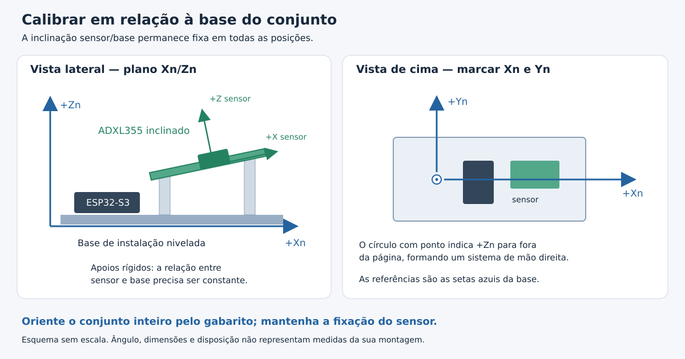

# Calibração completa com o ADXL355 inclinado

## 1. O que será calibrado

Será calibrado o conjunto montado: sensor, soldagem, placa/base e fixação. O ADXL355 pode permanecer inclinado quando sua posição em relação à base é rígida e constante. O resultado será uma aceleração no referencial Xn/Yn/Zn marcado na base.

Uma inclinação fixa distribui uma aceleração entre canais. O programa estima essa relação linear usando a gravidade em direções conhecidas e aplica a inversa nas aquisições posteriores. A matriz também incorpora ganho e misturas lineares entre canais. Seus elementos não devem ser interpretados isoladamente como sensibilidade transversal intrínseca ou como medida exclusiva do ângulo da soldagem.

O ensaio não corrige movimento relativo do módulo, ressonância do suporte, dependência térmica, não linearidade, atraso do filtro ou a orientação desconhecida da base na estrutura. Pedley (2015), AN4399, seção 7, fundamenta o modelo de 12 parâmetros. A nota técnica da Analog Devices sobre tensões mecânicas do ADXL355 fundamenta o cuidado com a montagem; links em REFERENCIAS.md.

## 2. Preparar e identificar a montagem

1. Mantenha a inclinação escolhida. O módulo deve ter suporte rígido; os pinos e cabos não devem funcionar como molas. Apoie pelos pontos de fixação disponíveis, com isolamento elétrico adequado.
2. Use a superfície pela qual o conjunto será instalado como referência geométrica. Marque **Xn**, **Yn** e **Zn**. Xn e Yn ficam no plano da base; Zn é normal a ela. Escolha os sinais formando um sistema de mão direita.
3. Fixe o conjunto inteiro em um gabarito com faces perpendiculares. Um bloco rígido com faces verificadas permite repetir as seis posições. Uma peça impressa em 3D deve ter sua geometria e sua fixação verificadas, especialmente quanto à planicidade e à perpendicularidade.
4. Confira a horizontalidade da superfície e as faces do gabarito com uma referência externa apropriada. Um esquadro e um nível ajudam na preparação; a precisão necessária depende do objetivo. O erro angular do gabarito entra no ajuste e não é removido por aumentar a duração da captura.
5. Escolha um identificador, por exemplo **NO01_M1**. Use-o em toda a campanha. Se mudar a relação entre o sensor e a base, adote uma nova montagem, como NO01_M2, e revise a calibração.
6. Fotografe a montagem e os sentidos positivos. Registre estado do Wi-Fi, alimentação, USB, faixa, taxa e filtros. A montagem final deve permanecer reproduzível.
7. Aguarde estabilização térmica, usando o tempo observado no ensaio de aquecimento. O ESP32 ao lado do acelerômetro pode aquecer a montagem. Mantenha sua condição de funcionamento semelhante entre as capturas e anote a temperatura.



No desenho, os ângulos são apenas ilustrativos. Posicione pela geometria do conjunto/gabarito. Antes da correção, as leituras do sensor inclinado podem ter componentes transversais mesmo com a base corretamente posicionada.

## 3. Realizar as seis orientações de ajuste

As setas abaixo são as **setas do conjunto**, não as marcações no chip. Em repouso, a seta positiva vertical para cima corresponde à componente positiva da aceleração medida.

| Posição | Como posicionar a seta positiva | Vetor esperado corrigido, em g, usando g0 |
|---|---|---|
| Xpos | +Xn vertical para cima | (1, 0, 0) |
| Xneg | +Xn vertical para baixo | (−1, 0, 0) |
| Ypos | +Yn vertical para cima | (0, 1, 0) |
| Yneg | +Yn vertical para baixo | (0, −1, 0) |
| Zpos | +Zn vertical para cima | (0, 0, 1) |
| Zneg | +Zn vertical para baixo | (0, 0, −1) |

Faça **três arquivos de 30 segundos por posição**, total de 18. Essa duração é uma escolha inicial do projeto. O programa descarta os primeiros 2 s na análise, mantendo o arquivo bruto completo. Você pode registrar por mais tempo; melhorar o posicionamento costuma ser mais útil que prolongar a média.

Entre repetições, afaste o conjunto da posição e volte a apoiá-lo na mesma face. Assim, a dispersão inclui o reposicionamento no gabarito. A fixação entre sensor e base permanece intacta. Depois de cada movimento, aguarde o repouso antes de iniciar o comando. Evite tensão nos cabos, tocar na montagem ou apoiar o chip/terminais na superfície.

## 4. Capturar no Windows

Extraia o pacote em uma pasta nova, instale `requirements.txt` conforme o README e abra PowerShell nessa pasta. Feche Monitor Serial e Serial Plotter. Confira a COM com `00_listar_portas.py`.

Para facilitar, defina o executável uma vez:

```powershell
$adxlPython = ".\.venv\Scripts\python.exe"
```

Coloque +Xn para cima e execute:

```powershell
& $adxlPython .\python\01_capturar.py --porta COM3 --duracao 30 --ensaio calibracao_completa --posicao Xpos --repeticao 1 --sensor ADXL355-01 --montagem NO01_M1 --referencial conjunto
```

Espere o salvamento completo. Reposicione e execute novamente mudando `--repeticao 1` para `2`, depois para `3`. Passe para a face oposta e repita com `--posicao Xneg`. Faça o mesmo para Ypos, Yneg, Zpos e Zneg. **A etiqueta identifica a posição física: o programa não gira a placa.**

Confirme ausência de perdas e execute temporização em um arquivo da campanha:

```powershell
& $adxlPython .\python\05_analisar_temporizacao.py "CAMINHO_REAL\aquisicao.csv"
```

O capturador salva cada execução em uma subpasta exclusiva de `dados/brutos/data/calibracao_completa`. Identidade, montagem, posição e repetição ficam no JSON. Copie CSV e JSON juntos. Não edite esses arquivos pelo Excel.

## 5. Ajustar a matriz

Use uma pasta que contenha somente os 18 arquivos selecionados desta campanha, com seus JSONs. Se há outras campanhas na mesma pasta, passe uma lista dos CSVs ou copie os pares CSV/JSON para uma pasta de seleção, preservando os originais e a justificativa da seleção.

```powershell
& $adxlPython .\python\03_calibrar_matriz_completa.py "dados\brutos\AAAA-MM-DD\calibracao_completa"
```

Substitua AAAA-MM-DD pela data real. O padrão usa `fichas/orientacoes_calibracao.json`, que descreve as seis faces e os eixos da base. Se personalizar as descrições, mantenha exatamente as mesmas na referência de validação. Direções adicionais conhecidas podem ser cadastradas em outro JSON com o mesmo formato; informe seu caminho por `--referencias`. Não use direções estimadas a partir do sensor que está sendo calibrado.

As médias dos três canais de cada arquivo entram no modelo. O programa verifica identidade, montagem, faixa, filtros, taxa, integridade, repetição, saturação, dispersão e cobertura das referências. Posto insuficiente ou resposta singular impede o cálculo. Metas numéricas amplas de ganho e condicionamento protegem contra erros grosseiros, sem substituir tolerâncias de datasheet ou análise de incerteza.

Por padrão, arquivos com desvio-padrão maior que 5 mg em qualquer canal são recusados para a calibração/validação estática. `--max-dp-mg` altera essa triagem quando houver justificativa. A quantidade mínima padrão é três arquivos por orientação no ajuste; `--min-repeticoes` permite um protocolo diferente, que deve ser documentado.

O ajuste cria uma pasta como `dados/calibracao/data_hora_microssegundos_calibracao_identificador`. O terminal mostra o caminho completo.

| Arquivo | Como avaliar |
|---|---|
| calibracao.json | Matriz C, offsets, referencial, exemplar, montagem, configuração, fontes e diagnóstico |
| calibracao_coeficientes.xlsx | Os 12 parâmetros com unidades: 3 offsets em LSB e 9 elementos em g/LSB |
| calibracao_medias_brutas.xlsx | Três médias, desvios, posição, repetição, temperatura e hash de cada captura |
| calibracao_repeticoes.xlsx | Dispersão entre as médias dos arquivos por posição |
| calibracao_residuos_ajuste.xlsx | Componentes corrigidas, referências e erros vetorial, angular e de módulo |
| consistencia_pares_opostos.xlsx | Desvio dos centros de pares opostos em relação ao bias estimado |
| matriz_correcao.png | Matriz multiplicada pela escala nominal, tornando-a adimensional |
| residuos_do_ajuste.png | Erros por componente e direção em cada arquivo |
| analise.json | Parâmetros, hashes, versão do pacote e estado da execução |

Os resíduos de ajuste medem a consistência dos próprios dados utilizados. Centros de pares discrepantes podem indicar posições não antipodais, deriva ou variação mecânica; não identificam sozinhos a causa. Uma boa norma não prova bom alinhamento. O JSON fica marcado como **ajustada_nao_validada**; o validador gera um relatório próprio sem modificar os coeficientes.

## 6. Validar com aquisições independentes

Faça registros novos depois do ajuste. Duas possibilidades:

**A — Validação em direções intermediárias conhecidas.** É a opção preferível para verificar outras direções além das usadas no ajuste. Prepare um gabarito de 45° verificado externamente. Não estime o ângulo apenas olhando a placa.

| Etiqueta | Vetor de referência, em g, usando g0 | Condição geométrica |
|---|---|---|
| xypos | (0,707107; 0,707107; 0) | +Xn e +Yn dividem a componente positiva; Zn horizontal |
| xyneg | (−0,707107; −0,707107; 0) | Posição oposta a xypos |
| xzpos | (0,707107; 0; 0,707107) | +Xn e +Zn dividem a componente positiva; Yn horizontal |
| xzneg | (−0,707107; 0; −0,707107) | Posição oposta a xzpos |
| yzpos | (0; 0,707107; 0,707107) | +Yn e +Zn dividem a componente positiva; Xn horizontal |
| yzneg | (0; −0,707107; −0,707107) | Posição oposta a yzpos |

O arquivo `fichas/orientacoes_validacao.json` contém esses vetores com mais casas decimais. Cada par com igual componente positiva está a 45° da vertical nos eixos envolvidos; o terceiro eixo é horizontal. Uma posição a 45° em apenas um plano, sem controlar o terceiro eixo, pode não corresponder ao vetor da tabela.

Faça pelo menos um arquivo de 30 s em cada posição; três arquivos por posição permitem avaliar a repetibilidade. Exemplo para xypos:

```powershell
& $adxlPython .\python\01_capturar.py --porta COM3 --duracao 30 --ensaio validacao_calibracao --posicao xypos --repeticao 1 --sensor ADXL355-01 --montagem NO01_M1 --referencial conjunto
```

Repita para as demais etiquetas, reposicionando o conjunto. Depois:

```powershell
& $adxlPython .\python\11_validar_calibracao.py "PASTA_REAL_DAS_NOVAS_CAPTURAS" --calibracao "PASTA_REAL_DO_AJUSTE\calibracao.json"
```

**B — Nova campanha nas seis faces.** Se você ainda não tem um gabarito de ângulos intermediários, faça aquisições novas em Xpos/Xneg/Ypos/Yneg/Zpos/Zneg, usando o mesmo protocolo de validação e a pasta `validacao_calibracao`. Nesse caso, informe a referência de faces:

```powershell
& $adxlPython .\python\11_validar_calibracao.py "PASTA_REAL_DAS_NOVAS_CAPTURAS" --calibracao "PASTA_REAL_DO_AJUSTE\calibracao.json" --referencias .\fichas\orientacoes_calibracao.json
```

Essa opção verifica uma nova realização das poses de ajuste; não verifica outras direções. Em ambas, os registros devem ser realmente novos. O programa recusa os hashes usados no ajuste, mesmo quando o CSV foi renomeado ou copiado. Isso detecta reutilização de arquivos, sem certificar a independência física ou a exatidão do gabarito.

## 7. Interpretar a validação

Abra `validacao_residuos.xlsx` e `validacao_calibracao.json`. O validador aplica a matriz já estimada e não a reajusta para melhorar o resultado.

- **Erro por componente (mg):** diferença entre a média corrigida e a referência em Xn, Yn e Zn.
- **Erro vetorial (mg):** norma da diferença entre os vetores; inclui direção e amplitude.
- **Erro de módulo (%):** desvio da norma em relação à gravidade de referência.
- **Erro angular (graus):** ângulo entre o vetor corrigido e a direção de referência conhecida.

Metas iniciais de triagem: erro vetorial ≤10 mg, erro de módulo absoluto ≤1% e erro angular ≤0,5° em cada arquivo. São escolhas do projeto; não são tolerâncias normativas, especificações de fábrica ou incerteza. Informe metas diferentes pelo comando, quando houver justificativa:

```powershell
& $adxlPython .\python\11_validar_calibracao.py "PASTA_REAL_DA_VALIDACAO" --calibracao "PASTA_REAL_DO_AJUSTE\calibracao.json" --limite-vetorial-mg 10 --limite-norma-pct 1 --limite-angular-deg 0.5
```

Uma execução pode terminar normalmente e concluir **NAO ATENDE**: o programa calculou os resultados, porém as metas não foram satisfeitas. `analise.json: concluida` significa conclusão do processamento, não aprovação da calibração. Examinar a qualidade do gabarito e suas incertezas é parte da interpretação.

Se houver erro sistemático, revise geometria, sinais e referência. Se houver variação entre repetições, examine apoio, cabos, movimento e temperatura. Preserve todas as campanhas; uma exclusão deve ter causa técnica registrada.

## 8. Aplicar e preservar os resultados

Passe `--calibracao` com o caminho do JSON da matriz em cada análise. Nenhum registro interno do sensor será alterado. A sequência é **brutos → matriz e offset → grandezas em g → análise/filtros**, mantendo gravidade nas análises estáticas, térmicas e de Allan.

```powershell
& $adxlPython .\python\08_analisar_dinamico.py "CAMINHO_REAL\aquisicao.csv" --calibracao "PASTA_REAL_DO_AJUSTE\calibracao.json" --eixo z
& $adxlPython .\python\12_exportar_corrigido.py "CAMINHO_REAL\aquisicao.csv" --calibracao "PASTA_REAL_DO_AJUSTE\calibracao.json"
```

As colunas `ax_g`, `ay_g`, `az_g` agora representam Xn, Yn, Zn. As colunas `ax_raw`, `ay_raw`, `az_raw` continuam sendo as leituras originais do sensor. O JSON registra o referencial; sem calibração, g e m/s² usam os eixos do sensor e a escala nominal. A identificação da montagem também deve constar das novas capturas de ruído, dinâmico, Allan etc.

O arquivo da calibração guarda a configuração de faixa/taxa/filtros. A aplicação exige a mesma configuração e o mesmo exemplar/montagem. Ao instalar em uma estrutura, registre como Xn/Yn/Zn correspondem às direções longitudinais, transversais e verticais; a matriz desta bancada não determina essa instalação.

O padrão assume a gravidade de referência 9,80665 m/s². Para uma escala absoluta mais precisa, informe `--gravidade-local` com um valor conhecido e sua procedência. O programa usará esse valor na calibração e na validação. Isso não estabelece rastreabilidade por si só.

Ruído e Allan nos eixos corrigidos incluem a mistura dos canais pela matriz; não equivalem automaticamente a especificações de um canal nativo do chip. A calibração estática também não valida amplitude/fase em 0,5–50 Hz; essa etapa exige a comparação dinâmica prevista no projeto.
