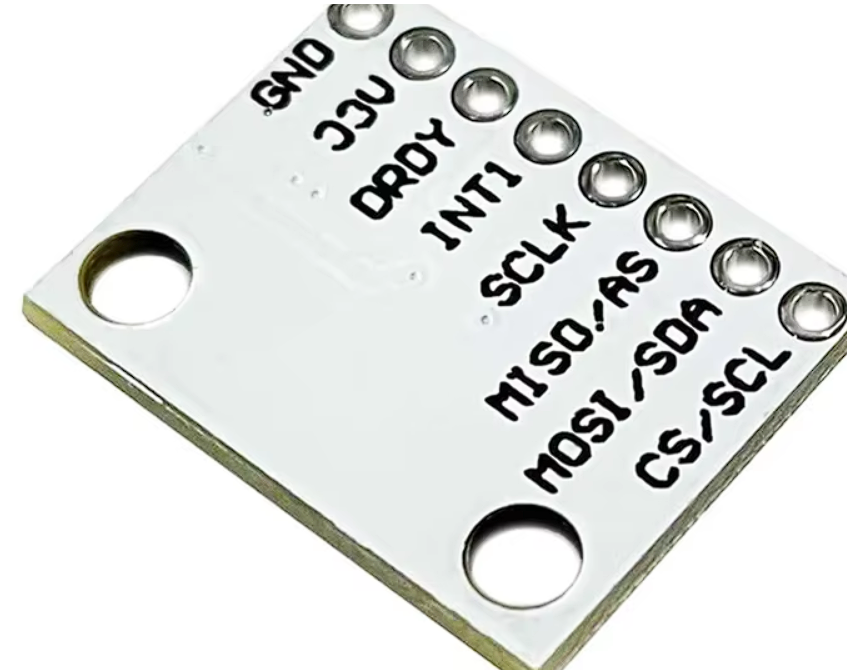

# Ligação e gravação

Use as inscrições da placa, não a ordem presumida dos furos. A foto identifica os terminais externos, mas não determina a orientação dos eixos do chip.

## Conectar sem alimentação

| ADXL355 | ESP32-S3 | Cor sugerida |
|---|---|---|
| GND | GND | Preto |
| 3V | 3V3 | Vermelho |
| DRDY | GPIO14 | Amarelo |
| INT1 | Livre | Sem fio |
| SCLK | GPIO12 | Azul |
| MISO/AS | GPIO13 | Verde |
| MOSI/SDA | GPIO11 | Branco |
| CS/SCL | GPIO10 | Laranja |

São sete fios curtos e firmes. Aproximadamente 10–20 cm é um ponto de partida de bancada, não especificação garantida de alcance. Alimente o terminal `3V` com 3,3 V, nunca com 5 V. O nome após a barra indica uma função alternativa de I²C; aqui a interface é SPI. O firmware controla CS em cada transação. Não ligue CS em 3V3 nem use INT1 no lugar de DRDY.

Pode usar cabos soldados diretamente ou jumpers com contatos firmes. Se usar protoboard, cada terminal de sinal ocupa uma linha elétrica diferente; não ponha todos na mesma fileira de cinco contatos interligados. A alimentação não precisa de cabo em Y.

A referência é a [ESP32-S3-DevKitC-1](https://docs.espressif.com/projects/esp-dev-kits/en/latest/esp32s3/esp32-s3-devkitc-1/user_guide_v1.0.html). GPIO10 não significa décimo pino do conector. Em outra placa S3, confira se os pinos estão disponíveis; se alterar a ligação, altere também `config.h`. Flash/PSRAM e periféricos integrados variam entre placas.

## Arduino IDE

1. Instale **esp32 by Espressif Systems** no Gerenciador de Placas. A versão usada na compilação do pacote é 3.3.6.
2. Abra `firmware/adxl355_aquisicao/adxl355_aquisicao.ino`. Mantenha `config.h` e `codec.h` ao lado dele.
3. Selecione **ESP32S3 Dev Module**, ou o perfil exato da sua placa. O código recusa o ESP32 clássico.
4. Configure flash, tipo de memória e PSRAM conforme a variante real. O programa não exige PSRAM.
5. Escolha a configuração de comunicação correspondente ao conector utilizado:

| Caminho USB | Configuração |
|---|---|
| USB nativo do S3, normalmente USB/OTG | USB CDC On Boot: Enabled; USB Mode: Hardware CDC and JTAG; Upload Mode: UART0 / Hardware CDC, quando essas opções aparecerem |
| Conversor USB–UART da placa, normalmente UART | USB CDC On Boot: Disabled; saída Serial pela UART; baud 921600 |

No USB nativo, o baud não determina a taxa física USB, mas mantemos o parâmetro 921600. Na UART, ele precisa coincidir. Não selecione DFU como substituto da serial de aquisição. A porta COM pode mudar após a gravação; liste-a novamente. Veja a [orientação oficial de CDC](https://docs.espressif.com/projects/arduino-esp32/en/latest/tutorials/cdc_dfu_flash.html).

Conecte o USB e carregue. Se houver erro de boot, segure BOOT, pressione e solte EN/RESET e mantenha BOOT até começar a gravação. Aguarde terminar e reinicie por EN se necessário.

Abra o Monitor Serial com **921600 baud** e **Nova linha**. Envie `INFO`: espere `pronto=1` e IDs `0xAD`, `0x1D`, `0xED`. A revisão `revid` pode variar. Envie `START,5000`: são esperadas aproximadamente 2500 amostras e um `#END` sem perdas. Feche o Monitor Serial antes de usar Python.

## Alterar configuração

`config.h` permite 500 ou 250 Hz e faixas ±2, ±4 ou ±8 g. O filtro interno acompanha ODR/4: 125 ou 62,5 Hz. Recompile e grave após alterações. Para a banda 0,5–50 Hz, mantenha inicialmente 500 Hz. Se mudar a faixa, faça calibração compatível; não reutilize coeficientes de outro exemplar ou faixa.
