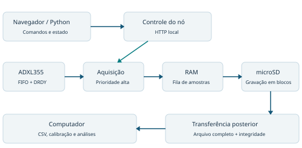
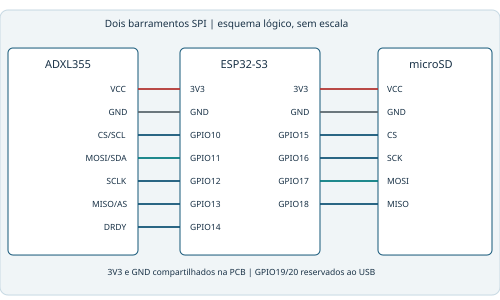
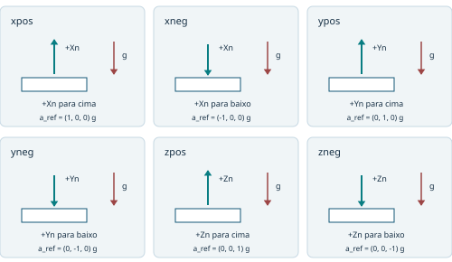

# Guia de configuração e ensaios

ADXL355 + ESP32-S3 | Wi-Fi, microSD e calibração do conjunto inclinado | v3.0.0

## 1. Objetivo e alcance

Este pacote transforma o conjunto em um registrador autônomo de bancada.
O computador ou celular envia comandos por Wi-Fi. O ESP32-S3 coleta as amostras,
grava no microSD e disponibiliza os arquivos depois da sequência. Uma queda
de Wi-Fi ou o fechamento do navegador não interrompe a aquisição em curso.



O pacote contem o firmware, a página web, os programas Python, configurações,
referências de orientação, testes e documentacao. Os analisadores da v2 foram
preservados e adaptados para a captura por armazenamento local.

**Situacao da entrega:** testes numéricos e de transporte simulado executados;
compilação com as bibliotecas reais do core Espressif e validação física ainda
pendentes. A verificação C++ no host usa interfaces de teste e não substitui
compilar no Arduino IDE. Consulte VALIDACAO.md antes da primeira campanha.

O uso inicial e com um unico no. Início remoto, timestamps em microssegundos
e acerto da hora do computador não comprovam sincronização entre vários nós.

## 2. Materiais e verificações iniciais

Prepare um ESP32-S3 com pelo menos 4 MB de flash, o módulo ADXL355 ja fixado
na sua PCB, o leitor SPI de microSD com alimentação de 3,3 V, cartao, cabos
curtos, fonte estável e um computador Windows com Python e Arduino IDE.
A PSRAM não é obrigatoria: a fila principal ocupa 64 KiB de RAM interna.

O firmware foi escrito para as APIs do Arduino-ESP32 3.x. O script opcional
de compilação por CLI indica 3.3.2 como alvo, mas não foi executado com a
toolchain real neste ambiente. A placa física e suas opções de flash precisam
ser conferidas no Arduino IDE.

Instale o core e as dependencias Python enquanto o computador possui internet.
Somente depois conecte-se a rede criada pelo ESP32, que não fornece internet.

Antes de alterar qualquer fio, desconecte USB e bateria. Para gravar o firmware,
use inicialmente apenas a alimentação USB do computador. Para ensaios autônomos,
a saida USB de 5 V do shield pode alimentar a entrada USB apropriada da placa S3.
O leitor e o sensor recebem 3V3 do circuito de alimentação, não 5 V nos pinos de sinal.

## 3. Ligacoes na PCB

Os números abaixo são GPIOs logicos, não a ordem física dos pinos no conector.
Preservam o mapa do ADXL355 adotado no guia anterior. Confirme que estão expostos
e livres na sua variante do ESP32-S3 antes de soldar o leitor.

| Módulo | Pino do módulo | ESP32-S3 |
|---|---|---|
| ADXL355 | VCC | 3V3 |
| ADXL355 | GND | GND |
| ADXL355 | CS/SCL | GPIO10 |
| ADXL355 | MOSI/SDA | GPIO11 |
| ADXL355 | SCLK | GPIO12 |
| ADXL355 | MISO/AS ou MISO/ASEL | GPIO13 |
| ADXL355 | DRDY | GPIO14 |
| ADXL355 | INT1 | Sem ligacao nesta versão |
| microSD | VCC | 3V3 |
| microSD | GND | GND |
| microSD | CS | GPIO15 |
| microSD | SCK/CLK | GPIO16 |
| microSD | MOSI | GPIO17 |
| microSD | MISO | GPIO18 |



Os GPIOs 19 e 20 permanecem livres para USB nativo. MOSI liga em MOSI e MISO
em MISO. Os dois CS são independentes e são acionados pelo firmware. Distribua
3V3 e GND na PCB; não é preciso um pino de alimentação separado para cada módulo.

Use o leitor informado para 3,3 V. Verifique se ele ja inclui os pull-ups
necessários ao cartao; não suponha que todos os módulos tenham o mesmo circuito.
Mantenha fios curtos, GND comum e desacoplamento próximo ao leitor. Picos de
corrente da gravação devem ser suportados pelo regulador da sua placa.

A placa e o sensor precisam ficar rigidamente unidos. A inclinação fixa pode
ser tratada pela calibração matricial; movimento relativo, folga ou flexao
variavel durante o ensaio não é corrigido por uma matriz estática.

## 4. Preparar o cartao

1. Copie para outro local qualquer arquivo importante que ja esteja no cartao.
2. Para a primeira validação, use um cartao FAT32 conhecido e em bom estado.
3. Formate apenas o cartao correto, nunca uma unidade escolhida por tentativa.
4. Ejete o cartao do computador e coloque-o nó leitor com o conjunto desligado.
5. O firmware criara `/ensaios/`; não é necessário criar pastas manualmente.

O firmware não formata nem apaga automaticamente dados. Ele verifica espaco
antes de cada registro. A 500 Hz, os registros binários de 32 bytes ocupam
aproximadamente 57,6 MB por hora, mais cabecalhos e metadados. Quatro horas
ocupam aproximadamente 231 MB. O cartao não deve ser retirado durante gravação
ou finalização. O CSV no computador e maior que o binário.

## 5. Instalar e configurar o Arduino IDE

1. Instale o Arduino IDE e o pacote **esp32 by Espressif Systems** pelo
   Gerenciador de Placas. Utilize uma versão 3.x compatível com sua placa.
2. Abra `firmware/adxl355_wifi_sd/adxl355_wifi_sd.ino`. Os arquivos `node.cpp`,
   `config.h`, `format.h` e `web_ui.h` devem estar na mesma pasta do sketch.
3. Selecione **ESP32S3 Dev Module** ou o modelo S3 específico da sua placa.
   Não selecione DOIT ESP32 DevKit V1 para este firmware.
4. Ajuste o tamanho e o modo da flash conforme a placa. Para placas com
   pelo menos 4 MB, uma particao como **Huge APP (3MB No OTA/1MB SPIFFS)**
   fornece espaco para o aplicativo. Esta versão não usa OTA nem SPIFFS.
5. Deixe PSRAM desativada inicialmente. O firmware não depende dela.
6. Para o conector USB nativo, quando essas opções existirem, selecione
   **USB Mode: Hardware CDC and JTAG** e **USB CDC On Boot: Enabled**.
7. Se utilizar o conector UART da placa, confira a porta correspondente e
   ajuste CDC On Boot conforme a saida serial desejada. A aquisição Wi-Fi não
   depende do Monitor Serial nem de um computador permanecer conectado.
8. Selecione a porta COM que aparece ao conectar a placa e use inicialmente
   upload a 115200 para facilitar o diagnóstico.
9. Compile antes de carregar. Não e necessário instalar bibliotecas Arduino
   de terceiros: WiFi, WebServer, SPI, SD e Preferences pertencem ao core.

Em `config.h`, confira GPIOs, SSID e senha. A senha inicial e `Ensaio355!`;
troque-a antes de usar a rede fora da bancada. Se mudar pinos, documente a
alteracao e confira se não pertencem a USB, flash ou outras funções da placa.

Clique em Carregar. Se ficar em Connecting, mantenha BOOT pressionado,
pressione e solte EN e solte BOOT quando comecar a escrita. Aguarde o upload
terminar. A compilação ou a gravação pode exigir ajustes especificos da placa;
preserve a mensagem completa se houver falha.

## 6. Conferir a primeira inicialização

Abra o Monitor Serial em **115200 baud**, com **Nova linha**, e pressione EN.
O firmware não espera a abertura do Monitor Serial para funcionar.

O início informa `#READY`, a versão, identificadores e disponibilidade do SD.
Envie `INFO`. Os tres identificadores esperados são:

| Campo | Valor esperado |
|---|---|
| DEVID_AD | 0xAD |
| DEVID_MST | 0x1D |
| PARTID | 0xED |
| REVID | Revisão reportada, preservada no diagnóstico |

Confirme `sensor_pronto=1`, `sd_pronto=1` e `tarefas_prontas=1`. Esses campos
indicam as verificações implementadas, mas não comprovam exatidão nem autenticidade
absoluta do componente. O comando STATUS mostra o estado; STOP solicita parada.
O firmware v3 não transmite linhas de amostras D pela serial.

## 7. Conectar pelo Wi-Fi e operar no navegador

1. No Windows ou celular, escolha a rede **ADXL355-ENSAIOS**.
2. Informe a senha definida em config.h. Aceite permanecer conectado mesmo
   que o sistema informe que essa rede não possui internet.
3. Digite **http://192.168.4.1** no navegador. Use HTTP, sem acrescentar HTTPS.
4. Clique em Identificação e confira sensor, cartao e tarefas.
5. Preencha identificação do exemplar e da montagem. Mantenha esses nomes
   constantes durante os ensaios do mesmo conjunto.
6. Selecione funcional, zpos, referencial conjunto, 30 s, 500 Hz, faixa 2,
   repetição 1, quantidade 1, atraso 5 s e radio ativo.
7. Apoie o conjunto e clique em Iniciar sequência.
8. Aguarde adquirir, esvaziar o buffer e finalizar. A criacao dos hashes também
   leva tempo, especialmente em aquisições longas.
9. Somente depois do fim, clique em Listar aquisições. Os arquivos permanecem
   no cartao. Para o download verificado e a conversão automática, use Python.

Não e transmitida uma curva de amostras em tempo real. O acompanhamento remoto
e de estado, contagens e erros. Isso reduz o trabalho de comunicação durante
a medição. Transferências de arquivo ficam bloqueadas até terminar a sequência.

O botao Parar cancela também as repetições restantes. Um registro encerrado
antes da duração prevista permanece identificado como interrompido. Ele não
e aprovado como uma campanha completa pelos analisadores espectrais.

## 8. Preparar o Python no Windows

Extraia todo o ZIP para uma pasta própria. Não execute dentro do arquivo
compactado e não copie a pasta .venv de outro projeto. Um caminho curto, como
`C:\TFC\ADXL355_WiFi_SD`, facilita a operação; espacos e acentos podem ser usados
com caminhos corretamente entre aspas.

Instale Python 3.12 de 64 bits pelo site oficial, se ainda não tiver Python.
Feche e reabra o terminal depois da instalação. Dentro da pasta que contem
README.md, requirements.txt, firmware e python, abra o PowerShell e execute:

```powershell
py --version
py -m venv .venv
.\.venv\Scripts\python.exe -m pip install -r .\requirements.txt
```

Não e necessário ativar o ambiente virtual nem alterar a política de execução
do PowerShell. Nas proximas secoes, definiremos um atalho apenas nesta janela:

```powershell
$PyEnsaio = ".\.venv\Scripts\python.exe"
& $PyEnsaio .\python\00_controlar_no.py --help
```

O `&` executa o programa cujo caminho esta na variavel. Se fechar o PowerShell,
defina `$PyEnsaio` novamente, ou use o caminho completo ao executavel.

Captura HTTP e conversão CSV usam a biblioteca padrão. As bibliotecas de
requirements.txt são necessárias para análises, graficos e XLSX.

Se aparecer NameResolutionError para pypi.org, o ambiente virtual pode ja
existir: a falha e na rede/DNS da instalação, não uma prova de incompatibilidade
do numpy. Reconecte o computador a internet e repita apenas a instalação.
Não use --trusted-host nem desative a verificação TLS para contornar DNS.

Para uma instalação sem internet no PC de ensaios, baixe as rodas em outro
Windows com a mesma versao/arquitetura Python:

```powershell
py -m pip download -r .\requirements.txt -d .\wheels
```

Copie wheels e o pacote para o PC de ensaios e instale:

```powershell
.\.venv\Scripts\python.exe -m pip install --no-index --find-links .\wheels -r .\requirements.txt
```

As rodas não acompanham este ZIP, pois dependem da versão do Python e do sistema.

## 9. Primeira aquisição por Python

Conecte-se a rede do ESP32. A COM não é usada nesta etapa. Execute:

```powershell
& $PyEnsaio .\python\00_controlar_no.py info
& $PyEnsaio .\python\00_controlar_no.py status
& $PyEnsaio .\python\01_capturar_wifi.py --duracao 30 --ensaio funcional --posicao zpos --repeticao 1
```

O cliente ajusta a hora de identificação, envia um comando com identificador,
aguarda a sequência, baixa os arquivos, verifica hashes/CRC e cria CSV e JSON.
Ele imprime o caminho real do CSV. Copie esse caminho para uma variavel:

```powershell
$CsvEnsaio = "COLE_AQUI_O_CAMINHO_REAL_DO_CSV"
& $PyEnsaio .\python\02_verificar_funcional.py "$CsvEnsaio"
& $PyEnsaio .\python\05_analisar_temporizacao.py "$CsvEnsaio"
```

A expressão COLE_AQUI e uma instrucao, não um nome de arquivo existente.
Os nomes dos programas usam sublinhado: `02_verificar_funcional.py`.
Não escreva `02\_verificar\_funcional.py`, porque as barras criam subpastas.

O valor nominal e 256000 LSB/g na faixa 2. A gravidade em repouso deve gerar
uma norma próxima de 1 g. Com sensor inclinado, podem existir componentes
significativas em mais de um eixo. A matriz depois expressara o resultado
nos eixos marcados da base; não espere eixos brutos alinhados automaticamente.

O primeiro ensaio verifica funcionamento. Ele não comprova resposta dinâmica,
incerteza ou desempenho em amplitudes pequenas de uma estrutura real.

## 10. Baixar aquisições ja existentes e retomar falhas

Se iniciou pelo navegador ou fechou o cliente, consulte:

```powershell
& $PyEnsaio .\python\00_controlar_no.py listar
& $PyEnsaio .\python\13_baixar_dados.py --todos
```

`--todos` baixa apenas campanhas com manifesto de finalização. Os arquivos
ficam em `dados/brutos/recuperados/ID_DA_AQUISICAO`. Repetir o comando reutiliza
arquivos que coincidam com os hashes, sem substitui-los por dados diferentes.

Para retomar uma campanha específica na mesma pasta do download anterior:

```powershell
& $PyEnsaio .\python\13_baixar_dados.py --run ID_REAL --saida "PASTA_REAL_DO_DOWNLOAD"
```

Substitua ID_REAL pelo identificador retornado por listar. Um .download.part
e um download local ainda incompleto, não o arquivo bruto aprovado. A retomada
utiliza o tamanho ja recebido e verifica SHA-256 antes de renomear o arquivo.

Se o START tiver resposta incerta, não envie outro START por tentativa. Consulte
STATUS e request_id; depois procure a campanha existente. A idempotencia do
firmware cobre a repetição do último request_id enquanto essa sessao de boot
permanece em memória, não uma garantia distribuida atraves de reinicializações.

Para importar pelo cartao, copie a pasta inteira da campanha, incluindo
raw.bin, meta.json, manifest.json e events.log. Execute:

```powershell
& $PyEnsaio .\python\14_converter_binario.py "PASTA_COPIADA\raw.bin" --xlsx
```

O navegador acrescenta o ID ao nome sugerido dos downloads. Se baixar assim,
organize cada campanha em uma pasta e restaure os nomes acima, ou informe
explicitamente --metadados, --manifesto e --log ao conversor.

## 11. Preparacao comum dos ensaios

1. Identifique o exemplar e a montagem. Fotografe a posição e registre a fonte
   de alimentação, apoio, cartao, firmware, taxa, faixa e modo de radio.
2. Mantenha fios com folga e alivio de tração. Não deixe cabos puxarem o sensor.
3. Use apoio firme, nivel/gabarito e ambiente tranquilo para ensaios estáticos.
4. Determine o aquecimento pelo ensaio térmico. Nos demais ensaios, aguarde a
   estabilizacao observada. Na primeira campanha, documente o tempo adotado.
5. Não aplique passa-altas aos brutos. Gravidade e offset são informações dos
   ensaios estáticos, térmico e de Allan.
6. Antes de aceitar um registro, confira integridade, continuidade e saturação.

Os tempos, repetições, bandas e metas deste guia são escolhas do protocolo de
bancada, não exigencias literais das fontes nem tolerancias de uma norma.

## 12. Calibração matricial: sensor inclinado

Marque Xn e Yn na base/PCB e defina Zn pela regra da mao direita. O referencial
deve permanecer o mesmo em todas as capturas e na aplicação da matriz. A
inclinação fixa do ADXL355 em relação a essa base permanece durante o ensaio.

O modelo e `a_conjunto = C (r - b)`: r são os tres brutos em LSB; b são tres
offsets; C e uma matriz 3 x 3 em g/LSB. O ajuste estima o modelo direto por
mínimos quadrados e depois o inverte. Cada media de arquivo tem o mesmo peso.

Use um gabarito com faces ortogonais verificadas e nivele cada posição. O
próprio sensor sob calibração não deve ser usado como referência independente
para determinar os ângulos. Inclinar a placa na mao e atribuir vetores exatos
não fornece uma referência conhecida.

| Etiqueta | Posição física | Vetor de referência normalizado |
|---|---|---|
| xpos | +Xn para cima | (1, 0, 0) |
| xneg | +Xn para baixo | (-1, 0, 0) |
| ypos | +Yn para cima | (0, 1, 0) |
| yneg | +Yn para baixo | (0, -1, 0) |
| zpos | +Zn para cima | (0, 0, 1) |
| zneg | +Zn para baixo | (0, 0, -1) |



Uma seta positiva para cima corresponde a leitura estática positiva nessa
direcao. Estes vetores são alvos no referencial do conjunto, não uma previsao
das componentes brutas do sensor inclinado. A gravidade local pode ser informada
em m/s2 ao ajuste; sem referência local, o programa adota 9,80665 m/s2 e essa
hipotese precisa constar do trabalho.

O roteiro pronto conduz seis posições, tres registros de 60 s por posição:

```powershell
& $PyEnsaio .\python\16_executar_roteiro.py .\configuracoes\calibracao_18_arquivos.json
```

Edite os nomes de exemplar e montagem no JSON antes de executar. Em cada etapa,
reposicione, apoie, aguarde estabilizar e digite CONFIRMO. O nó executa as tres
repetições daquela posição sozinho. O computador conduz a passagem para a
próxima posição; cada registro aceito continua autônomo se o PC desconectar.

Copie os seis caminhos de pastas impressos ao longo do roteiro. Para analisar,
informe as seis pastas da calibração (cada uma contem tres CSVs):

```powershell
$PastaXpos = "PASTA_REAL_XPOS"
$PastaXneg = "PASTA_REAL_XNEG"
$PastaYpos = "PASTA_REAL_YPOS"
$PastaYneg = "PASTA_REAL_YNEG"
$PastaZpos = "PASTA_REAL_ZPOS"
$PastaZneg = "PASTA_REAL_ZNEG"
& $PyEnsaio .\python\03_calibrar_matriz_completa.py "$PastaXpos" "$PastaXneg" "$PastaYpos" "$PastaYneg" "$PastaZpos" "$PastaZneg"
```

Alternativamente, copie exclusivamente essas seis pastas para uma pasta pai e
informe a pasta pai. Não inclua ruído, dinâmico ou validação nessa entrada.
Leia as tabelas de medias brutas, coeficientes, residuos e pares opostos.
O arquivo calibracao.json e salvo com status ajustada_nao_validada.

Metas iniciais de triagem: erro vetorial de 10 mg, erro de norma de 1% e erro
angular de 0,5 grau; a dispersão estática e triada em 5 mg por eixo. Esses
valores podem ser alterados por argumentos e não representam incerteza.
Não escolha apenas os resultados mais favoraveis. Repita registros com causa
identificada de invalidade e preserve os originais e a justificativa.

## 13. Validação independente da calibração

Adquira novos registros, sem reutilizar os CSVs do ajuste. O roteiro proposto
usa seis posições a 45 graus em pares de eixos, com gabarito externamente
verificado. Os vetores estão em fichas/orientacoes_validacao.json.

```powershell
& $PyEnsaio .\python\16_executar_roteiro.py .\configuracoes\validacao_6_arquivos.json
```

Se não conseguir realizar esses ângulos com referência conhecida, não atribua
as direcoes ideais a posições improvisadas. Use novas capturas nas seis faces
ortogonais e informe --referencias fichas/orientacoes_calibracao.json ao
validador. Isso verifica novos registros nas faces, mas não cobre ângulos novos.

Agrupe apenas os novos arquivos e defina os caminhos reais:

```powershell
$CalEnsaio = "CAMINHO_REAL\calibracao.json"
$PastaValidacao = "PASTA_REAL_COM_OS_NOVOS_REGISTROS"
& $PyEnsaio .\python\11_validar_calibracao.py "$PastaValidacao" --calibracao "$CalEnsaio"
```

O validador confere hashes para recusar arquivos de ajuste e calcula erros
vetoriais, de norma e de direcao. Uma norma próxima de 1 g sozinha não comprova
alinhamento: uma rotacao também preserva essa norma. O programa não regrava os
coeficientes nem ajusta novamente o sensor para melhorar a validação.

Use a mesma faixa, taxa, filtros, exemplar e montagem da calibração. Alterar
a geometria relativa sensor/base exige reavaliar a matriz. A calibração estática
não comprova amplitude dinâmica, resposta em frequência nem incerteza rastreavel.

## 14. Ruído, densidade e repetibilidade

Com o conjunto estabilizado e rigidamente apoiado, execute cinco registros de
120 s na mesma posição. Não toque na montagem e evite equipamentos vibratorios.

```powershell
& $PyEnsaio .\python\01_capturar_wifi.py --duracao 120 --ensaio ruido --posicao zpos --repeticoes 5 --intervalo 10
```

Copie a pasta pai gerada para `$PastaRuido`. Ela deve conter somente essa
sequência de cinco arquivos, com seus JSONs.

```powershell
$PastaRuido = "PASTA_REAL_DA_SEQUENCIA_DE_RUIDO"
& $PyEnsaio .\python\04_analisar_ruido_psd.py "$PastaRuido" --calibracao "$CalEnsaio"
& $PyEnsaio .\python\05_analisar_temporizacao.py "$PastaRuido"
& $PyEnsaio .\python\06_analisar_repetibilidade.py "$PastaRuido" --calibracao "$CalEnsaio"
```

Antes de possuir calibração validada, omita --calibracao; o resultado será no
referencial nominal do sensor. Não misture essa saida com dados corrigidos nos
eixos da base sem identificar a diferenca.

O ruído usa Welch, janela Hann, 50% de sobreposicao e PSD unilateral com
normalizacao density. A ASD e a raiz da PSD, expressa em microg/raiz(Hz).
A banda de RMS padrão e 0,5-50 Hz. A densidade equivalente padrão considera
10-40 Hz e corresponde a raiz da potencia integrada dividida pela largura
da banda. Inspecione os picos: esse número inclui ambiente, montagem e eletrônica,
e não é automaticamente a densidade intrinseca de ruído branco do componente.

Ajuste a banda de densidade quando necessário e justifique a escolha:

```powershell
& $PyEnsaio .\python\04_analisar_ruido_psd.py "$PastaRuido" --densidade-fmin 10 --densidade-fmax 30 --calibracao "$CalEnsaio"
```

Para repetibilidade, examine DP entre medias, amplitude entre medias e dispersão
dos RMS. Evite CV de medias proximas de zero. Para remontagem, repita tres a
cinco instalações mantendo a geometria sensor/base, registre o reposicionamento
e compare esses indicadores separadamente da repetibilidade sem remontar.

## 15. Regularidade temporal e influencia do Wi-Fi

Primeiro execute os registros com radio ativo. Depois repita a mesma montagem,
taxa, faixa e duração com radio desligado:

```powershell
& $PyEnsaio .\python\01_capturar_wifi.py --duracao 120 --ensaio validacao_wifi --repeticoes 5 --radio ativo
& $PyEnsaio .\python\01_capturar_wifi.py --duracao 120 --ensaio validacao_wifi --repeticoes 5 --radio desligado
```

No segundo caso, a rede desaparece e retorna ao fim de toda a sequência. O
atraso inicial e aplicado a cada registro; os intervalos também são programados
no no. Reconecte-se a rede quando ela retornar. O cliente possui margem adicional
de espera (padrão 1800 s, alteravel por --margem) e não cria outra aquisição por falha de conexão.

```powershell
$PastaAtivo = "PASTA_REAL_DOS_REGISTROS_ATIVOS"
$PastaDesligado = "PASTA_REAL_DOS_REGISTROS_SEM_RADIO"
& $PyEnsaio .\python\15_validar_armazenamento_wifi.py "$PastaAtivo" "$PastaDesligado"
```

Examine taxa efetiva, distribuicao dos intervalos, lacunas, erros, perdas
detectadas e pico do buffer. O FIFO armazena 32 conjuntos XYZ; ele não substitui
o buffer de RAM nem suporta atrasos arbitrários. Ao detectar desalinhamento,
FIFO perdido ou fila cheia, o firmware encerra o registro em vez de inventar
amostras. Alguns contadores são limites inferiores de perda, não uma contagem
exata de todas as amostras fisicas perdidas.

As metas de 1% para desvio de taxa e jitter são triagem inicial do projeto,
não exigencias do fabricante. O ISR registra o instante observado da borda DRDY;
atrasos de interrupção precisam ser avaliados e não são uma referência temporal
externa calibrada. Para a escala de frequência, os analisadores usam a taxa efetiva.

Teste também manter apenas as consultas leves de STATUS e interromper/reconectar
o Wi-Fi. Compare o arquivo recebido com o manifesto. Um arquivo integro prova
que a transferência coincidiu com o armazenado, não que não houve perda anterior
durante a medição. A continuidade e verificada separadamente.

## 16. Aquecimento e deriva: partida a frio

Edite configuracoes/aquecimento_partida_frio.json para os seus identificadores.
O perfil fornece 3600 s, 500 Hz, atraso zero, uma repetição e radio ativo.

1. Com o nó ocioso e conectado, grave a configuração para a próxima partida:

```powershell
& $PyEnsaio .\python\00_controlar_no.py armar-partida --config .\configuracoes\aquecimento_partida_frio.json
& $PyEnsaio .\python\00_controlar_no.py info
```

2. Confirme autostart_armado=true. A configuração não inicia o ensaio agora.
   Qualquer reinicialização, inclusive EN, consome a partida armada. Depois
   de armar, não pressione EN nem regrave o firmware; desligue o conjunto ocioso.
3. Desligue e deixe o conjunto desenergizado por pelo menos 30 min.
4. Posicione-o rigidamente antes de ligar. Energize e não toque na montagem.
5. A configuração e consumida uma unica vez ao iniciar o firmware. A gravação
   comeca após inicializar sensor/cartao/tarefas e o pre-roll de 100 ms.
6. Não e preciso conectar ao Wi-Fi para o ensaio iniciar. Registre que o zero
   do arquivo corresponde ao início de aquisição, não ao instante elétrico exato
   de energizacao. O JSON informa start_boot_us.
7. Ao terminar, conecte-se, liste e baixe o arquivo.

```powershell
& $PyEnsaio .\python\13_baixar_dados.py --todos
& $PyEnsaio .\python\07_analisar_deriva_aquecimento.py "$CsvEnsaio" --janela 60
```

Atualize `$CsvEnsaio` para o arquivo térmico. Examine medias por minuto,
temperatura interna, RMS e deriva em relação ao primeiro intervalo. A temperatura
interna e convertida nominalmente; não é um termometro ambiente calibrado.
A regressao aceleracao-temperatura e exploratoria: tempo e temperatura variam
juntos e o programa não aplica compensacao térmica automaticamente.

Para desarmar uma partida ainda não realizada, use a acao desarmar-partida.
Se uma queda de energia reiniciar o nó durante o ensaio, ele não iniciara
indefinidamente outra campanha, pois a flag e de uso unico.

## 17. Ensaio dinâmico em barra

1. Fixe uma extremidade da barra em apoio firme. Monte o conjunto de maneira
   rigida próximo da ponta livre e registre a massa adicionada e a posição.
2. Prenda os cabos próximos ao apoio, com folga até o sensor. A bateria e a
   caixa também alteram a dinâmica se forem presas na barra; documente a montagem.
3. Alinhe uma direcao conhecida do conjunto com o movimento predominante.
4. Inicie um registro de 120 s. Aguarde aproximadamente 10 s.
5. Desloque a ponta poucos milimetros e solte suavemente, sem impacto forte.
6. Aguarde decair e repita a excitação duas ou tres vezes no arquivo.
7. Faca cinco arquivos, mantendo condições semelhantes. Pare se houver folga
   ou saturação. Se mudar a faixa, registre e use calibração correspondente.

```powershell
& $PyEnsaio .\python\01_capturar_wifi.py --duracao 120 --ensaio dinamico --posicao zpos --repeticoes 5 --intervalo 20
```

Análise a pasta dessa sequência:

```powershell
$PastaDinamico = "PASTA_REAL_DA_SEQUENCIA_DINAMICA"
& $PyEnsaio .\python\08_analisar_dinamico.py "$PastaDinamico" --eixo auto --calibracao "$CalEnsaio"
```

O eixo auto e escolhido pelo maior RMS filtrado em cada arquivo. Para comparar
uma mesma direcao física entre repetições, prefira selecionar explicitamente
--eixo x, y ou z depois de aplicar a matriz. A banda padrão e 0,5-50 Hz.

O filtro Butterworth e aplicado com ida e volta; o processamento não representa
um filtro causal de tempo real. As bordas são excluidas das métricas. A frequência
dominante e o bin de maior PSD na banda; a tabela informa a resolucao espectral.
Ela não é automaticamente a frequência natural de um modo identificado.

Examine sinal, PSD, RMS, pico e proximidade da saturação. Essa montagem confirma
variação dos registros e repetibilidade; não calibra amplitude ou resposta em
frequência. O sensor também responde a mudancas de orientação durante movimentos.

## 18. Desvio de Allan

Mantenha o conjunto estático, termicamente estabilizado, com montagem e alimentação
documentadas. Adquira 2 a 4 h sem passa-altas. Escolha um modo de radio e mantenha-o
na campanha. Se houver lacunas, não una trechos como se fossem continuos.

```powershell
& $PyEnsaio .\python\01_capturar_wifi.py --duracao 14400 --ensaio allan --posicao zpos --radio ativo
& $PyEnsaio .\python\09_desvio_allan.py "$CsvEnsaio" --pontos 60 --calibracao "$CalEnsaio"
```

Atualize o caminho do CSV. O programa calcula Allan sobreposto, em g, para
tempos de integração até aproximadamente um decimo do registro. A subtracao
de uma constante melhora a condição numerica e não remove a deriva temporal.
Não se aplica passa-altas nem detrend linear a essa serie.

Quatro horas a 500 Hz correspondem a aproximadamente 7,2 milhoes de linhas.
Planeje espaco em disco e RAM no PC (16 GB são preferiveis para registros longos).
O Excel não comporta toda essa serie em uma planilha; a exportacao XLSX contem
apenas o resumo quando excede seu limite de linhas. O CSV preserva todos os dados.

Leia curvas e tabelas por eixo. O mínimo observado não é automaticamente
instabilidade de bias; a identificação dos mecanismos requer examinar trechos,
inclinacoes e condições ambientais. Pares sobrepostos não são independentes.
Esse ensaio caracteriza estabilidade estocastica, não resposta dinâmica estrutural.

## 19. Comparacao futura com instrumento de referência

Esta etapa exige equipamento calibrado e excitacao/registro apropriados.
O pacote preserva os dados para essa comparacao, mas não implementa uma
calibração normativa nem um mecanismo de sincronização entre instrumentos.
Não há um script que declare conformidade com a ISO 16063-21.

Documente fixacao conjunta, direcoes, configurações, referências temporais,
incerteza do equipamento e banda útil. Compare frequências e amplitudes em
condições controladas. Para fase e análise modal multicanal, valide o alinhamento
e a deriva entre relógios durante toda a janela. Início remoto simultaneo e
hora do computador não substituem essa validação.

## 20. Interpretação, arquivos e backup

| Resultado | Interpretação inicial |
|---|---|
| IDs e configuração coerentes | Comunicação e programacao verificadas pelas rotinas implementadas |
| Integridade verificada | Arquivo recebido coincide com o manifesto local |
| Sem lacunas/perdas detectadas | Continuidade observada; confira também taxa e contagem |
| Matriz ajustada com residuos pequenos | Ajuste consistente nos dados usados; valide em novas capturas |
| Validação estática satisfatoria | Apoio para uso da matriz nessas condições, sem validar dinâmica |
| Pico repetivel na barra | Resposta repetivel da montagem; não prova exatidão da amplitude |

No cartao, cada campanha fica em `/ensaios/ID/`, com raw.bin, meta.json,
events.log e manifest.json. Durante gravação, o nome e raw.bin.part.
O ACK cria recebido.json e não apaga os brutos.

No computador, cada captura e cada análise recebe pasta exclusiva. Mantenha
CSV e aquisicao.json juntos, preserve os quatro arquivos originais e copie
o conjunto para outro dispositivo ao fim da campanha. Não use uma pasta
sincronizada em nuvem como unica cópia durante os testes.

Para exportar acelerações corrigidas sem alterar os brutos:

```powershell
& $PyEnsaio .\python\12_exportar_corrigido.py "$CsvEnsaio" --calibracao "$CalEnsaio"
& $PyEnsaio .\python\10_gerar_resumo.py .\dados\processados .\dados\calibracao
```

As planilhas de resultados são XLSX, evitando interpretação regional de CSV.
Para abrir um CSV manualmente no Excel, importe por Dados > De Texto/CSV,
delimitador virgula e localidade compatível com ponto decimal, removendo uma
conversão automática incorreta antes de aplicar os tipos. Nunca grave sobre o bruto.

## 21. Falhas e recuperacao

| Sintoma | O que conferir |
|---|---|
| Erro de compilação | Placa S3, core 3.x, arquivos do sketch juntos e primeira mensagem completa |
| Upload não conecta | Porta/conector, cabo de dados, BOOT+EN e Monitor Serial fechado |
| INFO sem resposta | 115200, Nova linha, USB nativo/UART escolhido e CDC On Boot |
| IDs 0x00 ou 0xFF | Alimentação, GND, CS, SCK, MOSI/MISO, soldas e variante dos pinos |
| SD indisponivel | 3V3, cartao/FAT32, CS15 e demais pinos, regulador e contatos |
| Rede sem internet | Normal no ponto de acesso; permaneca conectado e abra o IP local |
| No ocupado | Aguarde finalizar/intervalo ou solicite STOP; não inicie duplicatas |
| Sem DRDY | Fio DRDY14, alimentação e modo de medição; não trocar por INT1 sem alterar o firmware |
| FIFO/filas perdidos | Atraso, alimentação ou configuração; execute testes de temporizacao e cartao |
| Hash/CRC falhou | Preserve arquivos; repita download em pasta nova e examine cartao/alimentacao |
| Calibração rejeitada | Poses, sinais, referencial conjunto, identificação, config e independencia |
| Nenhum CSV valido | Confirme se houve registros e finalização; uma COM aberta não faz a captura v3 |

Não desligue enquanto houver aquisicao/finalizacao nem retire o cartao nesse
estado. Depois de concluído, termine os downloads, feche a pagina/cliente e
desligue. Uma interrupção de energia pode perder dados ainda em RAM ou causar
dano ao sistema de arquivos; CRC e flush periódico não tornam FAT32 transacional.

Se a pasta puder ser lida e houver raw.bin.part, copie-a primeiro. Para examinar
somente blocos inteiros do prefixo:

```powershell
& $PyEnsaio .\python\14_converter_binario.py "PASTA_COPIADA\raw.bin.part" --recuperar-parcial
```

O modo parcial não ignora CRC errado e não aprova continuidade. Se não houver
cabecalho/JSON utilizavel, o conversor não inventa configuração nem referência.

## 22. Treinar e verificar o pacote sem hardware

Os testes geram sinais artificiais e arquivos temporários durante a execução. Para testar sem montar o nó, rode:

```powershell
& $PyEnsaio -m unittest discover -s .\tests -p "test_*.py" -v
```

Os testes numéricos e HTTP usam dados conhecidos. Alguns testes opcionais
precisam de g++ ou Node.js para verificar o formato C++ e a sintaxe JavaScript.
O script ferramentas/verificar_sintaxe_firmware.py e uma verificação limitada
no host, não uma compilação do core Espressif ou simulacao elétrica.

O roteiro de aceite físico e o formulário de validação acompanham VALIDACAO.md.
As referências e a relação entre cada ensaio e a literatura estão em REFERENCIAS.md.
